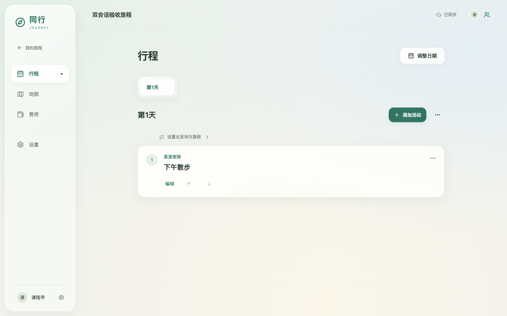
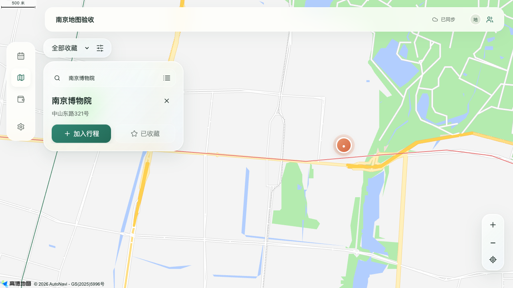
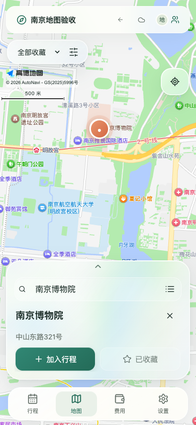
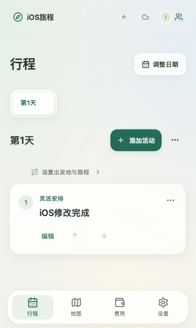

# 2026-10-13 验收与部署记录

## 实现基线

正式设计 v0.9 / C23，加上本轮账号、独立域名及设备适配决定。正式源代码位于 `app/`，历史原型和 Sites 参考未进入运行产物。账号使用手机号或邮箱加密码；本次按用户决定不发送短信、邮件验证码。

## 自动化和浏览器验证

- 本地 Node v24.16.0 / macOS arm64：32 项单元和集成测试通过，覆盖密码/会话/CSRF、账号隔离、真实 SQLite、邀请、成员移除、继任、两种权限模式、过半删除恢复、发生时序合并、幂等、离线日期引用、备份回退后的权限、安全账本及请求日志脱敏。
- 服务器 Node v22.22.1 / Linux：在 `/tmp` 独立目录，以空白环境、随机 loopback 端口、低优先级运行 backend、backup、AMap 代理三组测试，25/25 通过，4.22 秒。该次包含添加请求 ID 前的后端版本；请求 ID 的新增用例在本机通过。临时目录已清理。
- npm audit 完整依赖和生产依赖均为 0 vulnerabilities。
- 最终本地浏览器套件 7/7 通过，20.5 秒。检查 1440×900、1024×768、390×844、360×780 视口，截图保存在本机 `.local/evidence/`。
- 真实浏览器使用全新注册账号和真实 HTTP/SQLite/SSE；地图连接实际高德服务。浏览器业务测试不拦截 API，不预装旅程。
- 已完成两独立会话的邀请加入、实时修改；A 断网修改并刷新重开，B 随后修改，A 恢复网络后按发生时序保留 B 的新内容；直接越权删除返回 403；创建者删除及恢复同步到同伴；预计费用转实付后保持一条记录。
- 地图验证使用真实南京 POI，收藏保存高德地点 ID 与 GCJ-02 坐标，步行路线取得路径与分钟数；桌面和手机地图容器覆盖整个视口。
- 离线修改日期后立即创建新日期活动，联网后日期引用有效；旅程和计划日删除恢复、离开页面后未完成输入、首页和旅程共享设置均验证。
- iPhone 15 设备参数下使用真实 WebKit 引擎；Pixel 7 参数下使用 Chrome 触屏环境。反馈开关持久化，减少动态/透明设置和 PC 鼠标光效经过浏览器检查。

## 本地容量实测

Apple M5、10 逻辑核、16 GiB，macOS arm64，Node v24.16.0。运行 `node app/scripts/load-check.mjs`，使用临时 SQLite WAL / FULL，1 个旅程、1 个计划日、10 项活动；10 个账号各 5 个独立会话，共 50 条 SSE，10 个客户端完成 3 轮并发修改。鉴权、CSRF 和每分钟 500 请求限制保持启用。

| 指标 | 实测 |
|---|---:|
| 60 个读写 API 的 p95 | 15.561 ms |
| 读取 / 写入 p95 | 4.209 / 15.639 ms |
| API 错误 | 0 / 60 |
| 请求发出至 SSE 接收 p95 | 15.033 ms |
| SSE 通知收到 / 预期 | 1500 / 1500 |

含准备阶段共 171 个 HTTP 请求，最终全部内容和游标核对通过。测试走本机 loopback，生产服务器受独立 CPU 限额约束，其公开网络延迟另在部署验收中记录。

## 证据边界与待验证项

自动测试运行在桌面上的 Chrome/WebKit 和手机视口。实体 iPhone、Android 的震动马达、扬声器、软键盘和摄像头尚未现场验收。iOS 通用网页按钮没有通用振动接口，设置使用原生 switch 触感；支持 `navigator.vibrate` 的触屏浏览器调用 10ms 振动。提示音默认关闭，用户开启后直接由点击触发 Web Audio。

扫码使用浏览器原生 BarcodeDetector，能力缺失或摄像头不可用时可输入邀请编码或打开链接。后台推送、账单分摊、第三方预订、账号注销与自动密码找回不在本轮已确认范围。

## 服务器评估

主机 2 vCPU，3654 MiB 内存，2047 MiB swap，系统盘可用 29 GiB。2026-10-13 10:31:38 CST 的部署前采样：负载 0.07 / 0.12 / 0.14，可用内存 2519 MiB。游戏 l4d2.service MainPID 2503473、NRestarts 0、启动时间 2026-10-10 22:07:06 CST；控制器 MainPID 2427712、NRestarts 0、启动时间 2026-10-10 17:37:02 CST。

10:34:44 CST 只读 A2S/RCON 采样：地图 c6m1_riverbank，玩家 0，游戏 FPS 29.63。旅行应用独立用户、数据库、loopback 4177 与 systemd unit；CPU 40% 单核限额、MemoryHigh 384 MiB、MemoryMax 512 MiB，CPU/IO 权重降低。使用已有 443，无新增公网端口。

## 生产部署结果

- 访问地址：https://journey.jscloud.wang/ 。本地构建并上传 `2026-10-13-01`，源码提交 `6f90aec`，前端 build ID `8957c75011e37c3b`。
- 归档约 7.1 MiB，SHA-256 `2c4bb4d3290e6860d3323366bb79deb1bc5c48777d68476a84c6d264c031e9fd`，本地和远端校验通过。生产依赖随包上传，服务器未执行 npm 安装或前端构建。
- 独立 `journey.service` 已启用，监听 `127.0.0.1:4177`，nginx 独立站点通过校验。Let's Encrypt 证书有效期至 2027-01-11，安装路径和续签 reload hook 已登记到现有 acme.sh 定时流程。
- 数据库健康检查、公网 HTTPS、Apple 主屏幕图标均返回 200。一次公开首页探测耗时 76.9 ms。
- 对生产 HTTPS 运行完整浏览器套件：**7/7 通过，29.9 秒**。真实账号、邀请、两会话同步、离线重开/改期、权限边界、删除恢复、账本、高德 POI/收藏/路径、iOS WebKit 与 Android Chrome 均通过。
- 所有 QA 旅程在测试后退出并永久清除；8 个空白 QA 账号保留在数据库，普通用户无法访问他人账号或内容。未预装展示行程。
- 每日加密备份 timer 已启用，下一次为 2026-10-14 04:47:23 CST。首次与测试后备份均执行成功；主库、权限账本密文及 manifest 权限为 root 0600。恢复与篡改拒绝在服务器隔离测试中通过。

## 游戏与既有网站影响检查

2026-10-13 10:47:29 CST，旅行业务浏览器验收后：

| 检查 | 部署前 | 部署后 |
|---|---|---|
| 游戏 MainPID / 重启次数 | 2503473 / 0 | 2503473 / 0 |
| 控制台 MainPID / 重启次数 | 2427712 / 0 | 2427712 / 0 |
| 当前地图 / 玩家数 | c6m1_riverbank / 0 | c6m1_riverbank / 0 |
| 游戏 FPS 单次采样 | 29.63 | 29.96 |
| 主机可用内存 | 2519 MiB | 2386 MiB |
| L4D2 网站 | 200 | 200 |
| 旅行服务内存 | 未运行 | 128.46 MiB |

两个既有服务的启动时间保持不变，三个既有 nginx 站点文件 SHA-256 全部相同。nginx 使用正常 reload 装入独立域名。游戏当时无在线玩家，未执行满房游戏负载测试。旅行 CPU 限额实际为每秒 400ms，MemoryHigh 402653184 bytes、MemoryMax 536870912 bytes；应用日志无 500 错误。

## 交付与维护

源码已推送 `https://github.com/mcjiansheng/journey`。注册自己的手机号或邮箱后，按[运行维护](运行维护.md#首位管理员)初始化运维管理员；旅程创建者和成员权限在产品内管理。该文档包含备份、最新权限账本恢复、版本切换、首次上线撤回、日志定位及复测命令。

## 生产浏览器截图

以下内容由测试账号经正常操作创建，截取于生产 HTTPS 验收；相关旅程已在验收后清理。

