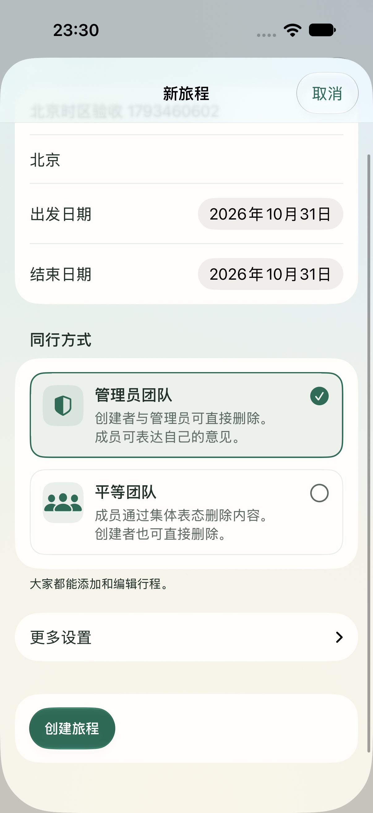

# 创建旅程交互修复（2026-10-31）

## 修改

- iOS、Android 创建旅程不再要求手选时区。默认使用设备当地时区，输入北京、南京等常用目的地后立即使用当地时区；识别失败也能继续创建。
- 常用目的地不再依赖地图接口。别名统一放在 `shared/destination-timezones.json`，原生代码由 `scripts/generate-destination-timezones.mjs` 生成，Web 直接读取同一份数据。
- 后台查询的旧结果不能覆盖新目的地或手动选择。手动时区和币种收进“更多设置”，时区使用中文名称和搜索；可以恢复自动选择。
- iOS、Android 创建页与管理页用两张团队卡片代替下拉列表，展示图标、说明、选中状态，默认选中管理员团队。
- iOS 点选团队卡片后收起键盘。创建失败保留表单；已收到创建成功响应后直接进入旅程，不再因为额外列表刷新失败误报创建失败。
- iOS 创建日期统一按设备当地 Gregorian 日历显示、计算和提交，修复凌晨提交为前一天的问题。

## 验证

- Web：97 项单元测试通过、1 项跳过；构建、格式检查通过。创建、团队卡片、更多设置的 Chrome/WebKit 回归共 10 项通过。
- iOS：应用与测试包编译通过，20 项单元测试和 1 项 UI 测试通过。模拟器完成“填写北京 → 切换团队卡片并收起键盘 → 直接创建 → 进入行程”；本地后端确认保存为 `Asia/Shanghai`、`admin`。见[验证记录](2026-10-31-创建旅程交互修复/ios-creation-verification.json)。
- Android：干净 CI 的单元测试、Lint 和 APK 构建全部通过，见 [Native clients CI](https://github.com/mcjiansheng/journey/actions/runs/41214995795)。本机 Gradle 缓存及本地 Maven POM 读取失败，未使用本机旧产物作为验证结果；未连接 Android 设备。

## iOS 实际界面

## 环境

工作期间意外关闭了 iCloud 的桌面与文稿同步，重新启用后已核对原仓库恢复，修改完整保留。iOS 编译验收使用本地临时副本，避免 iCloud 派生产物读写阻塞；Xcode 个人签名设置保留在工作区，未提交。

CI 显式使用 Xcode 26.3。macOS 15 runner 默认 Xcode 16.4 无法编译现有 Liquid Glass API，而镜像包含 Xcode 26.3，见 [GitHub runner 镜像说明](https://github.com/actions/runner-images/blob/main/images/macos/macos-15-Readme.md#xcode)。
