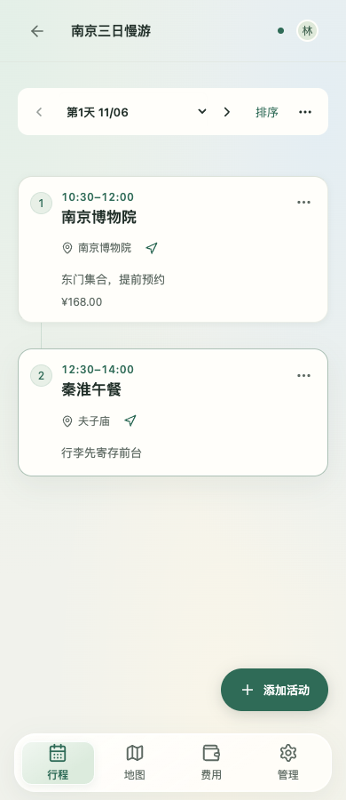
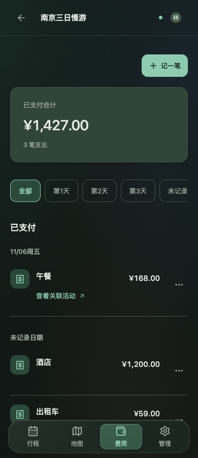

# 2026-10-31 前端设计审查修复

依据：[前端设计审查-2026-10-31](../评审输入/2026-10-31-前端设计审查/前端设计审查-2026-10-31.md)。修改保留在 `dev`，不发布到 `main`。

## 已修改

| 审查项 | 修改 |
| --- | --- |
| P0-1 | 时间冲突提示使用显式数值比较，相邻精确时间活动不再显示孤立的 0。 |
| P0-2、P0-3 | iOS、Android 活动、费用、路程编辑器采用自动保存、完成和收起；保留未完成草稿，管理信息自动保存。iOS toolbar 不再嵌套玻璃背景。 |
| P0-4、N-1 | 原生删除与参加意愿收进更多菜单，删除提供撤销；零表态计数隐藏。iOS 减少卡片内玻璃按钮。 |
| F-1 | Web 日期与排序合并到一行，调整日期收进菜单，删除重复日期标题；手机增加“添加活动”悬浮按钮，顶栏保留成员头像和同步状态。 |
| F-2、F-3 | 卡片显示备注、关联费用；无路程的入口在桌面悬停或手机排序时出现；排序模式标出精确时间活动。当前日为空时仍可操作行程外安排。 |
| F-4 | 菜单加入图标，编辑、地图、参加状态前置，删除置底，菜单最小宽度 200px。 |
| F-5 | Web 费用按日期分组，未记录日期只出现一次，筛选改为日期标签；单币种不重复代码，显示人均金额，关联活动链接左对齐。原生费用金额右对齐，隐藏无支出的币种。 |
| F-6 | 手机编辑器改单列，名称完整显示；空名称禁用活动“完成”；收起说明明确保留草稿；统一折叠箭头和输入框焦点。 |
| F-7 | 首页显示日期范围、天数、出发状态、成员头像，目的地色块区分旅程；无继续旅程时显示“全部旅程”，宽屏三列。旅程列表 API 仅对当前成员返回同行人姓名摘要。 |
| F-8 | 团队权限使用开关，移除成员收进更多菜单并保留确认；平等团队说明管理员用途；已同步时显示“立即同步”。 |
| F-9 | 地图加载失败隐藏无效控件，显示本地活动地点和收藏，可直接导航；桌面侧栏保留原有的默认收起动画，可在设置中关闭；已保存的个人选择继续生效。 |
| V-1、V-2、V-5、V-6 | 统一字号和圆角 token、加深次要文字和占位符、暗色主按钮使用深字浅绿底，强化选中态；改为明确的系统字体栈。手机输入框保留 16px。 |
| V-3、V-4 | 内容卡片使用实底，去掉卡片背景模糊；共享主题由 `design/tokens.json` 生成三端文件；删除 128 条已被覆盖的 CSS 声明；接入 Prettier 并格式化前端源码。 |
| N-2、N-3 | 原生页面标题、管理图标、主题色一致；Android 移除宣传标题和常驻同步条，固定时段选项，原生日期/时间选择，搜索尾部按钮与输入法搜索，灵活活动支持长按拖动。 |

自动保存复审另外修复了：草稿恢复覆盖同伴更新、丢弃草稿仍复用旧对象 ID、保存成功后未清理已提交字段、预计费用清空最后字段不保存、地图初始地点未保留、删除后撤销使用旧代次。

## 检查

- `npm run check`：95 项通过，1 项按浏览器启动环境规则跳过；生产构建通过。
- `npm run format:check`、`npm run tokens:check`：通过。生成的 `tokens.css` 排除手工格式化，避免与生成结果冲突。
- Web：1440px / 390px、亮暗主题的行程、费用、地图失败页已截图验收，证据在 `.local/evidence/design-review-1031/`。
- iOS：包含最后修复的 Debug 模拟器构建通过，arm64 / x86_64 均编译成功。应用及测试包 `build-for-testing` 通过，模拟器测试宿主启动失败：CoreSimulator Code 405 / server died，未执行用例。
- Android：JVM 19 项通过、1 项因未提供真实 API 环境跳过；Lint 0 错误、11 警告；APK 与 instrumentation 编译通过。未连接设备，原生 UI 验收未执行。
- Chrome / WebKit 浏览器回归累计 83 个不同场景通过，最后 16 项复跑全部通过；覆盖自动保存、离线重载、草稿恢复、路程、拖动、撤销、日期分组、团队模式、320–1440px 导航和亮暗主题。真实 POI 的 3 项测试因缺少高德 Key 未通过。

用户复核后，恢复“地图自动收起侧栏”默认开启。审查对默认展开的建议不覆盖此前已经确定的设置行为。截图中的完整侧栏对应手动关闭自动收起。恢复默认值后，Chrome / WebKit 的开关持久化与动画回归共 9 项通过。

## 未包含的扩展

付款人、费用分类和分摊结算需要扩展三端数据协议，本次保留现有费用字段。未加入“复制到另一天”快捷操作。CSS 已清理重复声明和基础 token，完整按组件重组其余历史样式留待后续。

真实高德 POI 搜索测试缺少本地 Key；无 Key 的页面处理已验证。

## 维护命令

调整主题后从根目录运行 `node scripts/generate-design-tokens.mjs`。从 `app/` 运行 `npm run check`、`npm run format:check`。原生主题生成文件与源码一起提交。

## 修改后的页面

| 手机行程 | 手机费用 |
| --- | --- |
|  |  |

[手机活动编辑器](2026-10-31-截图/手机活动编辑器.png) · [桌面地图不可用状态](2026-10-31-截图/桌面地图不可用-暗色.png)
