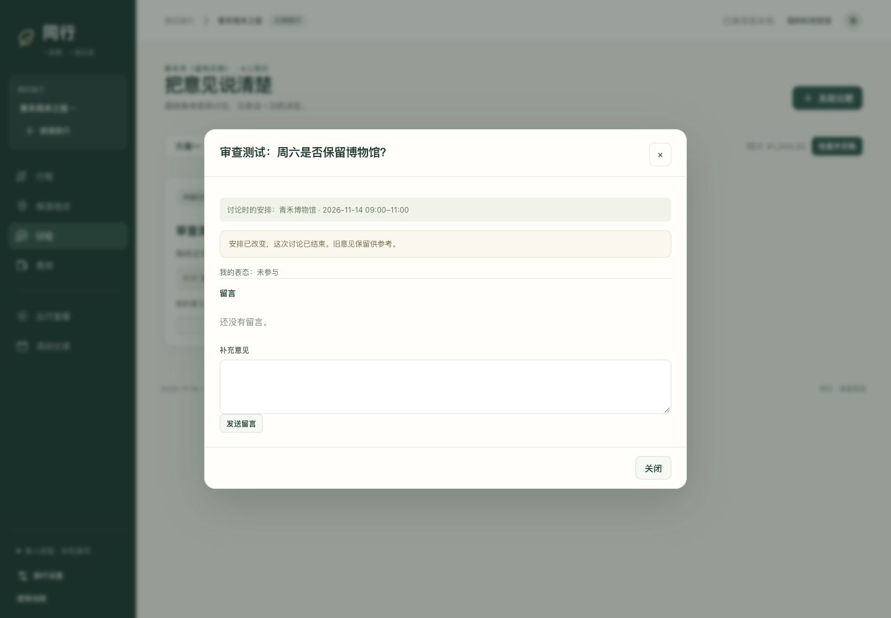

# 08｜原型证据与设计评审记录

版本 v0.9｜2026-10-12整理｜历史验证日期见各条记录

本文件集中保存原型的实际观察与已有验证结果，并说明它们对当前设计的用途。当前页面和功能要求见01–03，正式版验证计划见04，包含v0.9的时间联动、共享地图、团队治理、离线时序与临时删除恢复场景。

## 1. 原型材料

| 材料 | 记录的实现 | 已有验证 |
|---|---|---|
| 本地 `prototype/README.md` | 桌面、单人、本机保存；示例地点和手填交通 | 2026-10-07记录29项自动测试及部分浏览器流程；2026-10-08审查记录再次通过29项 |
| 本地 `prototype-v2/README.md` | 响应式本地原型；灵活活动、相对计划日及旧版讨论/定稿路径 | 2026-10-08记录19项模型测试、关键浏览器流程与模拟手机宽度检查 |

已有原型的账号、真实权限、云端同步和真实地点路线服务尚未实现。以上测试记录覆盖当时原型，正式版需按v0.9重新实现与验证。

## 2. 2026-10-08的观察与复测

当时通过源码、独立本机地址浏览器走查和自动检查记录以下问题。课程原则参考《人机交互概述》11–15页，以及《交互设计原则与目标》4–5、20–23、25–47页，相关课程材料路径沿原审查记录。

| 编号 | 当时旧原型的观察 | prototype-v2当时记录的复测 | 对当前设计的意义 |
|---|---|---|---|
| HCI-01 | 创建强制日期，活动默认精确时刻，尚未确定的信息阻塞起步 | 仅名称创建、加入第1天上午、后补日期通过 | 保留稀疏输入路径；本版进一步允许日常留白和直接使用 |
| HCI-02 | 改周日午餐价格使周六博物馆议题结束，预览未准确说明 | 无关变更不结束议题，相关变更与预览一致 | 沟通功能已取消；保留“局部变更不打断无关工作”的评审原则 |
| HCI-03 | 从预算提示进入费用页仍落到上次实际支出标签 | 对应入口定位到预计费用 | 本版取消预计对照；继续验证上下文跳转能定位到正确对象 |
| HCI-04 | 键盘切日期后焦点因整页重绘落回主体，选中态缺语义 | 第2天Enter后焦点保留、选中语义可读 | 正式版持续检查键盘焦点和同步后的输入位置 |

HCI-02历史截图：

当时prototype-v2还记录了360px四页面与1024px行程页无横向溢出、390px菜单和新建表单可达。实际手机触控、系统软键盘、全路径读屏和真实多端协作尚待正式版本验证。

## 3. 2026-10-12用户评审

| 反馈 | 正式版的设计回应 | 验证入口 |
|---|---|---|
| 后台感强，按钮和信息堆积 | 三主入口，复杂操作随当前对象展开 | 02布局、04首要动作任务 |
| 每个活动有图片，真实用户难以提供 | 无图为基础布局，图片作为可选补充 | 04稀疏与长内容走查 |
| 通勤数值没有编辑入口，来源文案冗余 | 真实输入/计算与路段编辑连通，常态显示方式及时长 | 01时间要求、04通勤任务 |
| 自动感言、英文标语、补零日序 | 文案使用用户内容、必要状态和自然动作名称 | 02内容规则 |
| 未知信息变成待核对清单 | 留白可保存使用，提示按实际动作出现 | 04留白和临时调整任务 |
| 定稿及解释原因负担过大 | 当前共享行程直接编辑和使用 | 06完整旅程 |
| 希望Liquid Glass与流畅动画 | 导航操作层采用玻璃材质，动画连续且可中断 | 02视觉规则、04真实设备检查 |

用户反馈属于设计输入，本版文档已据此调整。正式实现及体验效果在后续开发验证中记录。

## 4. 下一轮评审的证据要求

从空白账号实际创建旅程、添加无图活动，观察未知时间和价格如何呈现，再进行地图选址、多人编辑和途中记账。使用两次独立登录验证真实同步，避免通过单人演示推断协作体验。

每次记录版本、日期、设备、任务、实际行为、问题与复测结果。页面运行、自动检查、真实用户任务和真实设备走查分别列出。发现问题后先定位为内容来源、导航、输入反馈、同步或布局问题，再修改相应规格与实现。

本版任务和通过条件集中在[04](04-研究验证与实施计划.md)，避免多个文件维护不同验收清单。
