# 「同行 Journey」网页端与手机端设计审查

> 审查日期：2026-10-31　｜　对象：Web（app/）、iOS、Android 原生客户端
> 带交互目录的完整版见同目录 `前端设计审查-2026-10-31.html`（图片已内嵌，可直接用浏览器打开）。

整体气质是对的：薄荷绿、暖白和玻璃质感跟“熟人结伴旅行”很搭，登录页和桌面行程页已经有完成度。主要问题不在配色，而在三处：信息密度和层级（尤其手机端）、组件和字号没有收敛成体系，以及三个端的交互规则各走各的。

- **审查对象** app/ 当前构建（10-29）、iOS / Android 10-31 主题截图
- **方式** 本地起服务，用 3 人 × 3 天的南京样例旅程，在 1440px 桌面和 390px 手机、亮暗两色下逐页截图，结合源码核对
- **局限** 本地没有高德 Key，地图底图没有渲染，地图部分只评控件和布局

## 总评与评分

10 分制，7 分代表“可以交付但有明显可改进处”。

| 维度           | 分数 | 一句话                                                                             |
|----------------|------|------------------------------------------------------------------------------------|
| UI 风格 / 美学 | 7.5  | 风格统一、克制，有辨识度；玻璃材质用得太满，层级被拉平。                           |
| 色彩           | 7.0  | 主色选得好，暗色模式网页端合格；次要文字和占位符对比度不足，三端色值不一致。       |
| 排版 / 字号    | 5.5  | CSS 里有 27 种字号，最小 7px；没有字号阶梯。                                       |
| 组件与按钮     | 6.0  | 主/次按钮清楚；原生 select、复选框、▶ 折叠三角混在玻璃组件里显得“没做完”。         |
| 交互逻辑       | 6.5  | 自动保存、撤销、草稿恢复这些底层逻辑很扎实；行程页顶部操作分散，费用页缺“谁付的”。 |
| PC 端          | 7.0  | 布局舒展，侧栏好用；首页和行程页顶部留白多、信息少。                               |
| 手机 Web       | 6.0  | 首屏一半被导航和工具条占掉；编辑器两栏在 390px 下挤压。                            |
| iOS 原生       | 6.5  | Liquid Glass 接得不错；每张卡片都有两三个玻璃按钮，太重；保存按钮文字折行。        |
| Android 原生   | 5.0  | 交互仍是网页 10-27 修复前的版本：删除外露、上移/下移、营销式大标题。               |
| 三端一致性     | 4.5  | 保存方式、删除入口、表态入口、主色、“管理”图标在三端都不一样。                     |

**结论：** PC 端美观度和交互合理性基本达标，手机端（Web 和 Android）还没有达到同一水准。建议先修 4 个 P0，再把字号、圆角、颜色收敛成一套 token，并让三端共享，最后按页面逐个减法。网页端的视觉方向不用推倒重来。

## 做得好的地方

这些是后续修改中应该保留的东西。

**品牌气质统一**：薄荷绿 + 暖白 + 轻玻璃，配合指南针、纸飞机插画，“轻松结伴出行”的感觉很明确，没有落入常见的模板蓝紫渐变。

**登录页**：插画、卡片、分段切换和主按钮的比例都很好，桌面和手机都成立，是全站完成度最高的一页。

**触控与可达性底子好**：手机端按钮普遍 ≥44px，有 skip link、键盘排序、焦点样式，还有“减少动态效果 / 透明效果”设置，安全区也处理了。

**数据安全感**：自动保存、离线补传、撤销删除、草稿恢复，状态都有文案说明，协作产品最难的部分做扎实了。

**手机端弹窗改成底部抽屉**：符合单手操作习惯，键盘弹起时隐藏底栏也考虑到了。

**网页暗色模式**：同色相的深墨绿，而不是纯黑反转，卡片层次仍可辨认。

## P0 · 先修的 4 个问题

两个是可见 bug，两个是会让用户丢数据或误删的规则冲突。

### P0-1　行程卡片里出现孤立的数字「0」

**P0-1 · Bug**　｜　平台：Web 桌面 / Web 手机

**现象**

只要相邻两项都是“具体时间”且时间不重叠（例如 10:30–12:00 之后接 12:30–14:00），第二张卡片地点下方就会显示一个“0”。这是用户每天都会遇到的场景。

**原因**

`Itinerary.jsx` 里写的是 `{(late||overlap)&&<p className="timing-note">…}`。`travelAdvice()` 在不重叠时返回 `overlapMinutes: 0`，`null||0` 得到 `0`，React 会把数字 0 当文本渲染出来。

**修改**

```jsx
{(late > 0 || overlap > 0) && <p className="timing-note">…</p>}
```

顺手检查全项目其他 `{数字 && …}` 的写法，统一改成显式比较，并补一个“两个相邻精确时间活动”的渲染测试。

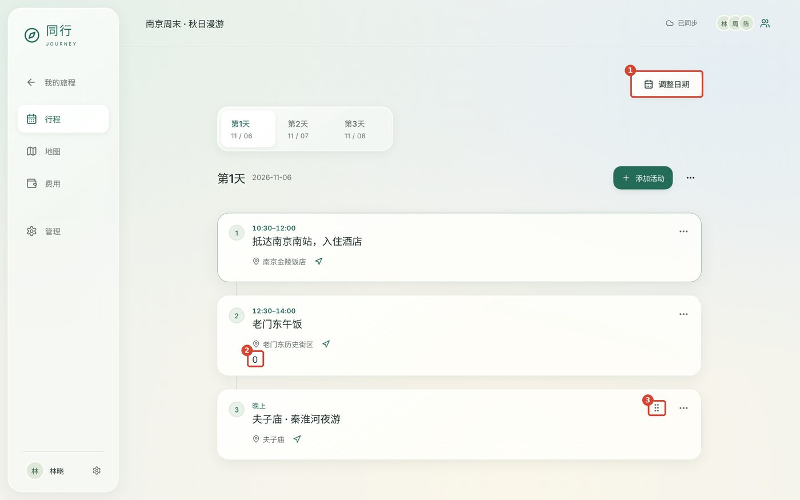

*② 孤立的“0”；① “调整日期”单独浮在右上角（见 F-1）；③ 只有灵活时间的活动有拖动柄（见 F-3）。*

### P0-2　活动编辑器的「保存」按钮被挤成竖排两行

**P0-2 · Bug**　｜　平台：iOS

**现象**

iOS 暗色截图里右上角显示为“保 / 存”上下两行，挤在一个圆形玻璃里，像一个未完成的图标，也降低了确认操作的可识别性。

**原因**

`ItineraryViews.swift` 的 toolbar 确认按钮同时用了 `.journeyButton(prominent: true)` 和 `.journeyOwnGlass()`，自定义的内边距和背景形状让 toolbar 给的宽度不够，文字被迫折行。费用、路程编辑器的「保存」用了同样的写法，也要一起检查。

**修改**

```swift
Button("保存") { save() }
  .lineLimit(1).fixedSize()          // 不允许折行
  .buttonStyle(.glassProminent)      // iOS 26 用系统样式，toolbar 已自带玻璃
// 或者直接用系统确认图标：
// Button { save() } label: { Image(systemName: "checkmark") }
```

iOS 26 的导航栏本身就是 Liquid Glass，toolbar 里的按钮不需要再叠一层自定义玻璃。

### P0-3　三个端的“保存”规则互相矛盾，用户换设备会丢输入

**P0-3 · 规则冲突**　｜　平台：三端

**现象**

- **Web：**：编辑器“填写后自动保存”，右上角「完成」，另有「稍后继续」保留草稿；管理页的旅程名称直接输入即保存。
- **iOS：**：编辑器是「取消 / 保存」显式提交；管理页有一个单独的「保存旅程信息」按钮。
- **Android：**：编辑器右上角只有 ✕，保存按钮在长表单最底部。

**为什么是问题**

同一个人在电脑上学会了“关掉就会保存”，到 iPhone 上点「取消」就会丢掉输入；反过来，在 iOS 上习惯了点保存，到网页上会找不到保存按钮。对一个强调离线和协作的产品，“我改的东西到底存没存”是最核心的信任感来源。

**建议**

三端统一为网页现在的模型（你们的同步层本来就是乐观更新 + 自动保存）：

- 编辑器右上角统一为「完成」，左上角或下拉手势为“收起”，都不丢数据；只有新建且完全空白时直接关闭。
- iOS 删掉「保存旅程信息」按钮，改成失焦即保存，并在行尾显示一个短暂的“已保存”勾。
- 编辑器顶部状态条三端用同一套文案：“已保存到此设备 / 正在同步 / 已同步”。

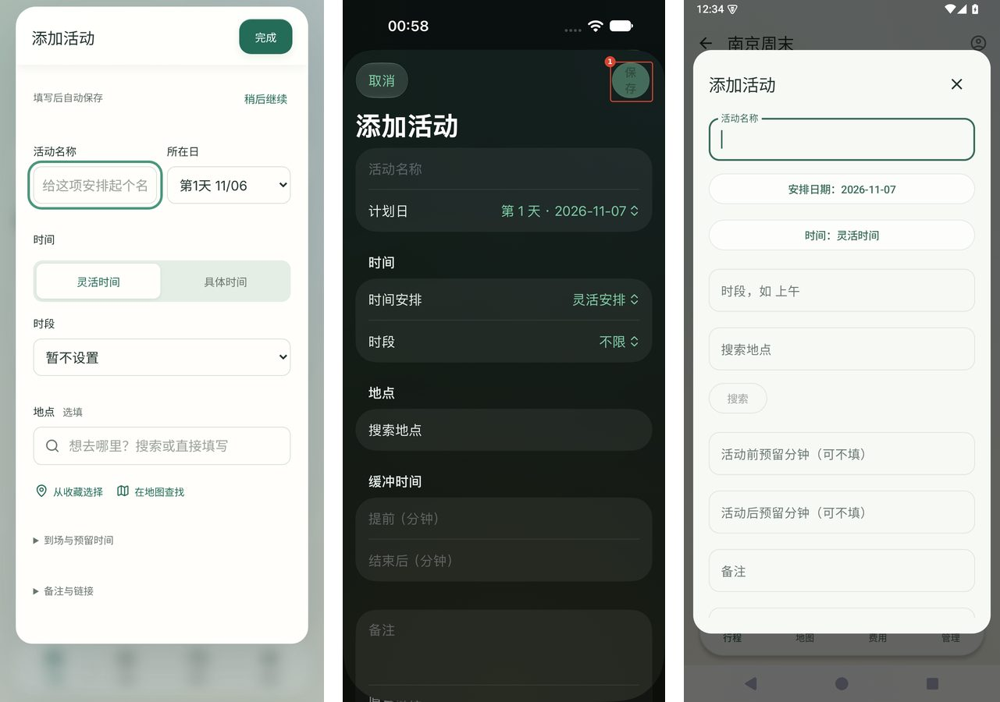

*同一个“添加活动”：Web 是“完成 + 自动保存”，iOS 是“取消 / 保存”（① 保存折行），Android 是“✕ + 底部保存”，日期和时间还做成了居中按钮。*

### P0-4　Android 把「删除」直接摆在每张卡片上，回到了 10-27 修复之前的状态

**P0-4 · 误操作风险**　｜　平台：Android

**现象**

行程卡片、费用卡片、地图收藏下都直接露出红色「删除」胶囊，旁边是「不参加」「希望删除 0」。网页端已按审查 H5 把删除收进 ··· 菜单并提供撤销，iOS 也收进了 ··· 菜单，Android 没有跟上。

**为什么是问题**

- 手机上滚动时很容易误触；卡片里一半面积是操作按钮，信息反而被挤到上半部分。
- “希望删除 0”在没人表态时也显示，是噪音。数字为 0 的计数不应出现。
- 平等团队里“删除”和“希望删除”同时出现，用户分不清两者的区别。

**建议**

与网页一致：卡片只保留信息和一个 ⋮ 菜单（Material 的 `DropdownMenu`），菜单内顺序为“编辑 → 查看地图 → 不参加 / 希望删除 → 分隔线 → 删除（红色）”；删除后底部 Snackbar 提供“撤销”。表态计数大于 0 时才以小标签显示在卡片上，例如“2/3 希望删除”。

## 交互逻辑

按页面排列，标注了在哪个端出现。

### F-1　行程页顶部堆了四层控件，手机首屏一半没有内容

**F-1 · P1**　｜　平台：Web 手机 / Web 桌面

**现象**

390px 手机上，从顶栏往下依次是：旅程标题栏 → 单独一行的「调整日期」 → 日期条（‹ 第1天 11/06 ⌄ › ＋） → “第1天 2026-11-06 / 排序 / ···”。第一张活动卡片从 y≈330px 才开始，844px 高的屏幕去掉底栏后，真正的行程只占一半多一点。

**具体问题**

1.  「调整日期」是低频操作（一趟旅行大概改一两次），却独占一整行。
2.  日期条里的「＋」紧挨着“下一天 ›”，看起来像“加一天”，实际是“添加活动”。添加活动是这页最重要的操作，却只有一个没有文字的加号。
3.  “第1天 2026-11-06”和日期条“第1天 11/06”是同一信息说了两遍。
4.  顶栏右侧云朵（同步）、双人（成员）、“林”（我）三个图标都很小，其中两个都是“人”的形状，难以区分。

**建议**

- 把「调整日期」挪进日期条的 ⌄ 下拉底部（“调整日期与天数…”）或当天的 ··· 菜单，删除独立的那一行。
- 删除日期条下方重复的“第N天 + 日期”标题，把「排序」和 ··· 放到日期条右侧。
- 添加活动改成带文字的主按钮：手机端用右下角悬浮按钮（底栏上方，“＋ 添加活动”），桌面端保留现在的位置。
- 手机顶栏只保留：返回、旅程名、成员头像叠放（点开团队）。个人设置从首页头像进入；同步正常时只显示一个小绿点，异常时才出现文字（网页已经对异常状态这么做了）。
- 桌面端同理：「调整日期」挪到日期标签右侧的同一行，删除上方那块大约 150px 的空白带。

这样手机首屏可以多出约 180px，大约能多露出一张半卡片。

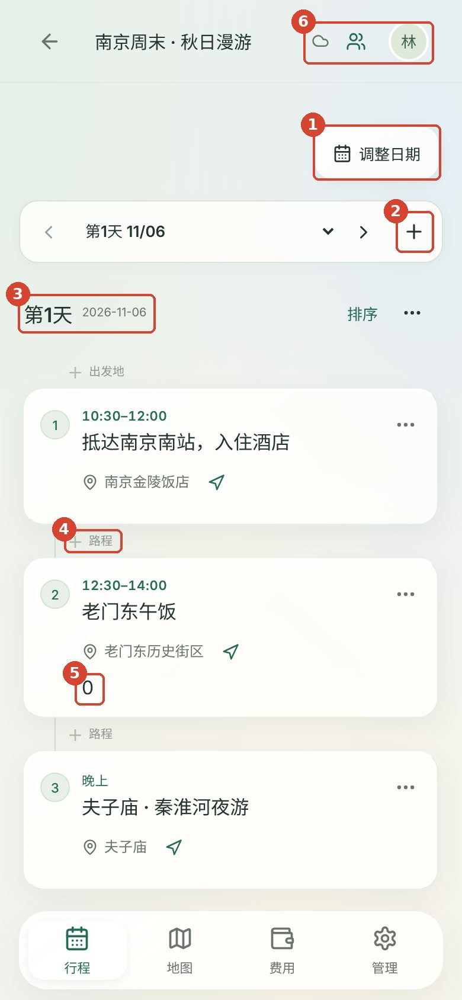

*① 独占一行的“调整日期” ② 含义不明的“＋” ③ 重复的日期标题 ④ 每两张卡片之间的“＋ 路程” ⑤ P0-1 的“0” ⑥ 三个相似的小图标*

### F-2　活动卡片该显示的不显示，“＋ 路程”这类空入口反复出现

**F-2 · P1**　｜　平台：Web

**现象**

- 样例里“东门集合，提前预约”“行李先寄存前台”这类备注，Web 卡片完全不显示，iOS 和 Android 却会显示。旅行当天最需要看到的往往就是这种备注。
- 卡片也不显示关联费用、谁不参加（只在有人表态时出现），但每两张卡片之间都有一行浅灰色“＋ 路程”或“＋ 出发地”。这些占位入口对比度只有约 2.4:1，看起来像禁用状态，又重复出现，形成视觉噪音。

**建议**

- 卡片固定结构：时间 → 标题 → 地点（+导航） → 备注（单行截断，灰色） → 底部小标签行（“¥168 · 1 人不参加”）。
- 没有路程时，卡片之间只保留时间线竖线，不放文字；悬停（桌面）或进入“排序/编辑”模式（手机）时才出现“＋ 路程”。已有路程时显示“🚇 公共交通 约 25 分钟 · 建议 12:05 出发”，这条信息很有价值，值得保留。

### F-3　只有部分卡片有拖动柄，规则对用户不可见

**F-3 · P2**　｜　平台：Web 桌面

桌面端只有“灵活时间”的活动出现 ⠿ 拖动柄，精确时间的活动没有（因为它们按时间自动排序）。设计上合理，但用户看到的是“有的能拖、有的不能”。

**建议**

精确时间的卡片在排序模式下显示一个小锁或“按时间排序”的提示；或者桌面端也采用手机的“排序”模式开关，平时都不显示拖动柄，进入排序模式后统一显示，并说明“具体时间的活动按时间固定”。

### F-4　「更多」菜单把删除放在第一项

**F-4 · P1**　｜　平台：Web

菜单只有“删除（红）/ 我不参加”两项，危险操作在最上面、离手指或指针最近，也没有图标。

**建议**

常用在上、危险在下：“编辑 / 在地图查看 / 复制到另一天 / 我不参加”，分隔线，最后是“删除”。每项加 16px 图标，菜单最小宽度 200px。手机端可以改为底部 ActionSheet，便于单手点按。

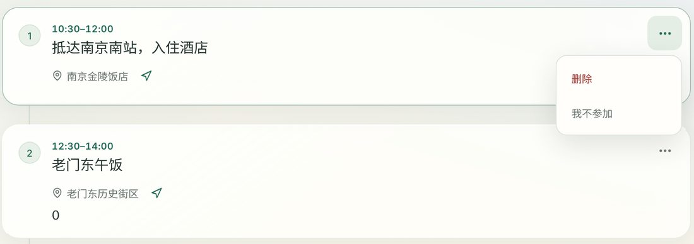

*当前菜单：删除在第一项，只有两项操作。*

### F-5　费用页：多人旅行最关心的“谁付的、怎么分”没有体现

**F-5 · P1**　｜　平台：Web / iOS / Android

**现象**

- 每笔费用都是同一个 \$ 小票图标，没有类别；看不出是谁付的。
- 每行都显示“日期未记录”，三笔都一样，成了噪音；“查看关联活动 ↗”比标题多缩进了约 20px，没有对齐（标注 ③④）。
- 总额卡写“CNY ¥1,427.00”，币种说了两遍（标注 ①）。卡片很高但只有一个数字和“3 笔支出”。
- “按日期查看”是浏览器原生 select，和周围的玻璃组件风格不一致，而且紧贴下面的“已支付”标题（标注 ②）。
- Android 端没有花费的币种也显示一张“已支付 0 JPY / 预计 0 JPY”的卡片。

**建议**

- 如果课程范围允许，至少加“付款人”（成员头像）。总额卡下方加一行“人均 ¥475.67 · 林晓 付了 ¥1,259”，这是费用页对“同行”这个主题最有说服力的一处。完整的分摊结算可以放到后续版本。
- 加 4–6 个类别（交通 / 住宿 / 餐饮 / 门票 / 购物 / 其他），各有图标和浅色底，列表一眼可扫。
- 列表按日期分组（组标题“11/06 周五”），“日期未记录”的放到最后一组，单行不再重复写。
- 日期筛选改成和行程页一致的分段标签（全部 / 第1天 / 第2天…），放在总额卡下方同一行。
- 总额只写“¥1,427.00”，币种代码只在多币种时显示。没有发生的币种不显示。

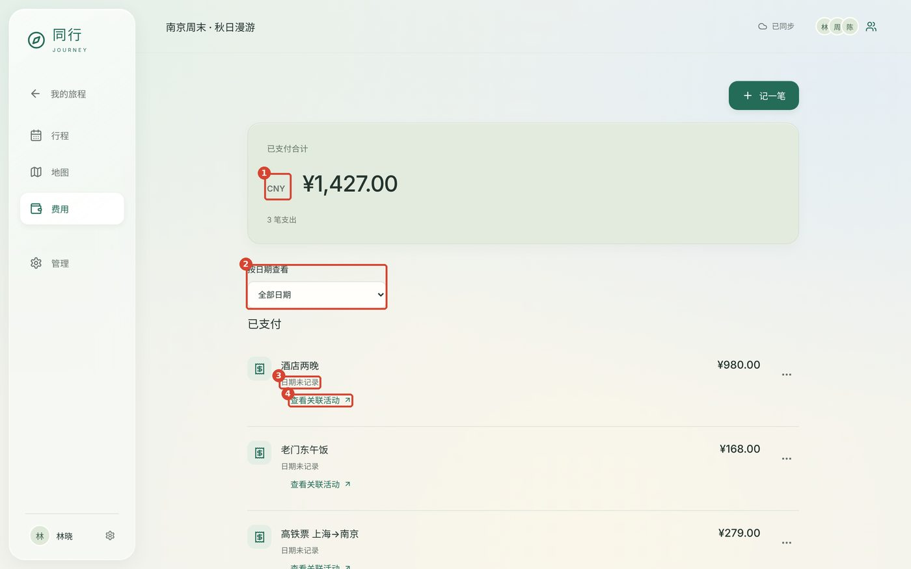

*① 币种重复 ② 原生 select，与下方标题间距过近 ③ 每行重复的“日期未记录” ④ 链接缩进与标题不对齐*

### F-6　活动编辑器：手机两栏挤压，折叠区用浏览器默认三角

**F-6 · P1**　｜　平台：Web

- 390px 下“活动名称”和“所在日”仍然并排，名称输入框只有约 150px 宽，占位文字被截成“给这项安排起个名”。名称是最重要的字段，应该独占一行。
- “到场与预留时间”“备注与链接”，以及管理页的“旅程删除与恢复”、团队弹窗的“已发出的邀请”，都用浏览器默认的 ▶ 三角，和其他地方的 › 箭头、lucide 图标不是一套。
- 焦点环是 3px 外描边加 4px 偏移，加上输入框自己的边框，看起来像两个框，并让输入框视觉上比右侧的 select 宽一圈。
- “填写后自动保存 · 稍后继续”这一条：“稍后继续”的意思不直观，用户不知道点了以后数据去了哪里。

**建议**

```css
@media (max-width:480px){ .modal .form-grid{grid-template-columns:1fr} }
details>summary{list-style:none;display:flex;align-items:center;gap:8px}
details>summary::-webkit-details-marker{display:none}
details>summary::before{content:"";width:16px;height:16px;
  background:currentColor;mask:url(chevron-right.svg) center/contain no-repeat;
  transition:transform .2s}
details[open]>summary::before{transform:rotate(90deg)}
input:focus-visible,select:focus-visible,textarea:focus-visible{
  outline:none;border-color:var(--accent);
  box-shadow:0 0 0 3px color-mix(in srgb,var(--accent) 22%,transparent)}
```

“稍后继续”改成“先收起，草稿会保留”。标题为空时「完成」显示为禁用态，旁边提示“填写名称后保存”。

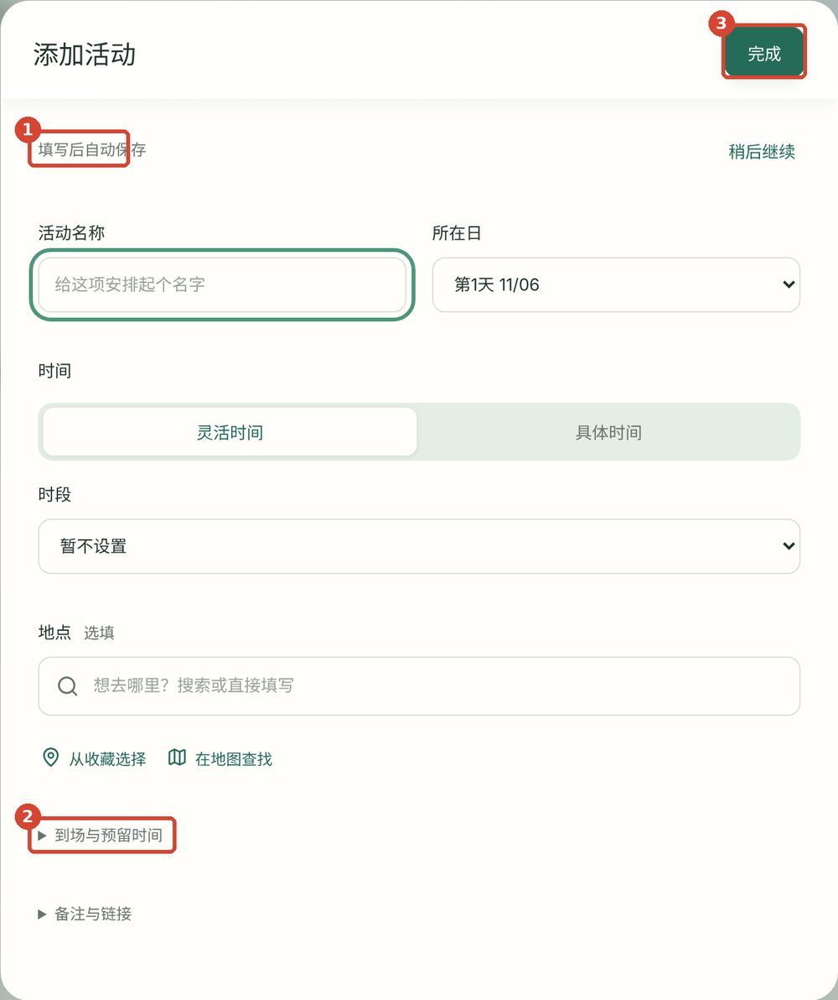

*① 状态文案 ② 原生 ▶ 折叠三角 ③ 标题为空时「完成」仍为可点击的实心按钮*

### F-7　首页信息太少，旅程卡片之间没有区分度

**F-7 · P2**　｜　平台：Web 桌面

- 两张卡片用同一个指南针图标、同样的版式，只靠名字区分；看不到行程天数、同行的人、距离出发还有几天。
- 没有“继续旅程”卡片时，列表标题仍然叫“其他旅程”，但上面并没有“主旅程”。
- 1440px 下内容集中在左上，下半屏是大片空白。

**建议**

卡片加入：日期范围“11/06–11/08 · 3 天”、状态标签（“6 天后出发 / 进行中 / 已结束”）、成员头像叠放、目的地首字或城市色块（从主色派生 4–6 个色相，按目的地哈希分配）。没有继续旅程时标题改为“全部旅程”。桌面端可以改成三列网格，或者左边是旅程列表、右边是“即将出发”的详细卡片。

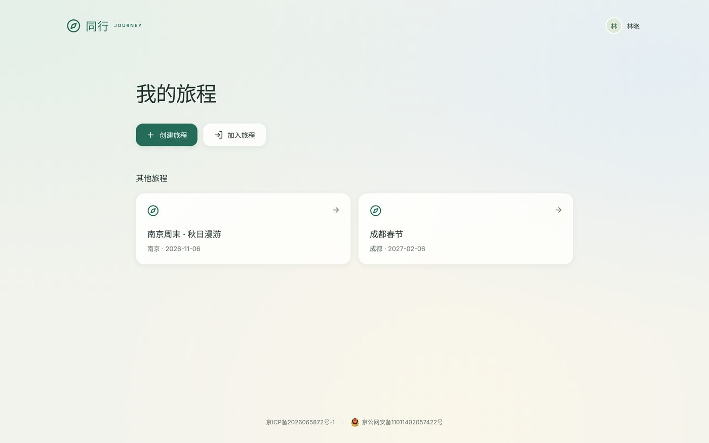

*桌面首页：两张卡片只有名字不同，下方大面积留白。*

### F-8　团队、同步两个弹窗的小问题

**F-8 · P2**　｜　平台：Web

- 成员行用原生复选框表示“管理员 / 可邀请”，而个人设置里用的是开关，同一类“权限开关”有两种控件。
- 红色“移除”紧挨着复选框，手机上很容易误点。建议收进成员行的 ··· 菜单，并二次确认。
- “平等团队”下仍然显示“管理员”勾选，需要一行说明它在平等团队里起什么作用（恢复权限），否则看起来像无效选项。
- 同步弹窗在“已同步”状态下仍显示「重试连接」按钮。正常状态下应隐藏或改成“立即同步”。

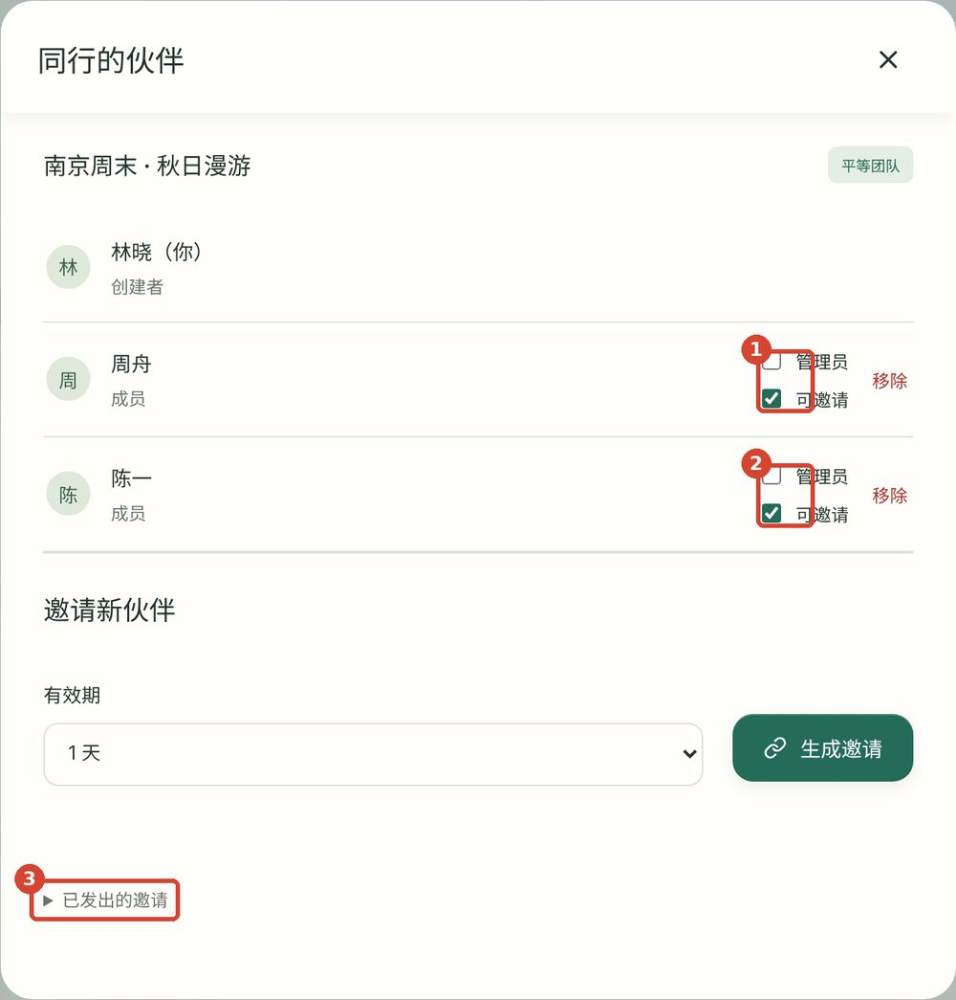

*①② 原生复选框 + 紧邻的“移除” ③ 原生 ▶ 折叠*

### F-9　地图页：加载失败时整屏不可用；进入地图时侧栏收缩

**F-9 · P2**　｜　平台：Web

- 底图加载失败时，缩放 ＋/− 和定位按钮仍然显示（标注 ①），点了没有反应。失败状态下应隐藏这些控件。
- 失败时整屏只剩一个提示框。收藏和当天活动的数据其实都在本地，可以在失败提示下方直接列出“当天地点”列表（名称 + 导航按钮），保证出行中依然可用。
- 从其他页进入地图时，200px 宽的侧栏会动画收缩成 72px 的图标栏，文字标签消失，导航位置也会跳动。建议地图页也保留图标下的小字（10–11px 换成 12px），或把收缩做成用户可选（现在设置里已有开关，默认可以改成不收缩）。

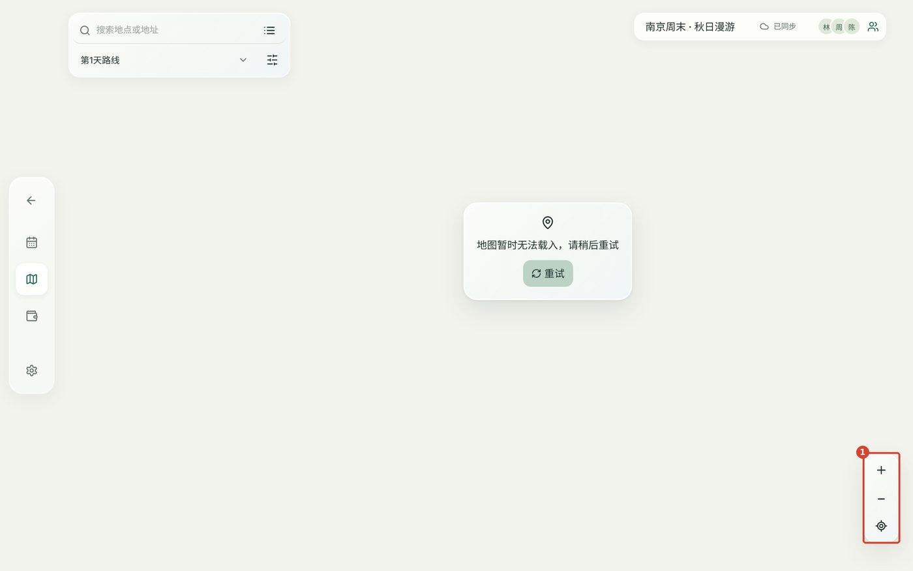

*本地无高德 Key 时的失败态（你们自己的验收截图也是同样的画面）。*

## 视觉与设计系统

数据来自对 app/src 全部 CSS 的统计。

### V-1　字号没有阶梯：27 种字号，最小 7px

**V-1 · P1**　｜　平台：Web

CSS 中共出现 27 种 font-size，其中 10px 有 35 处、11px 有 45 处，8px 7 处、9px 7 处，380px 以下的 eyebrow 甚至是 7px。后来的“Reading hierarchy”补丁层把一部分调大了，但规则分散在多处，最终生效的字号很难预测。

中文字形比拉丁字母复杂，12px 以下在手机上很难辨认。笔画多的字（如“赣”“鑫”）在 10px 时基本会糊成一团。

**建议：6 级字号 token，全站只用这 6 个**

```css
:root{
  --fs-caption:12px;  /* 最小：时间戳、角标，仅用于数字和短词 */
  --fs-meta:13px;     /* 地点、次要说明 */
  --fs-body:15px;     /* 正文、按钮、输入框（手机输入框保持 16px 防缩放） */
  --fs-title:17px;    /* 卡片标题 */
  --fs-section:20px;  /* 区块标题、日期标题 */
  --fs-page:28px;     /* 页面大标题（桌面可 32） */
}
```

搜索 `font-size:[789]px|1[01]px` 全部替换成上述 token；手机端不再单独缩小字号，而是缩小间距。

### V-2　次要文字、占位符和图标的对比度不足

**V-2 · P1**　｜　平台：Web / iOS

| 用途             | 颜色 / 背景           | 对比度 | 建议                                                    |
|------------------|-----------------------|--------|---------------------------------------------------------|
| 次要文字 --muted | `#69746d` / `#f3f3ed` | 4.36   | `#5e6a63`（5.07），在玻璃卡片上也能过 4.5               |
| 输入框占位符     | `#9ba298` / `#fffefa` | 2.60   | `#7d867c`（3.7），占位符至少 3:1                        |
| 路程行图标       | `#94a58e` / `#f3f3ed` | 2.35   | 改用 --muted                                            |
| 首页页脚         | `#8c978d` / `#f3f3ed` | 2.72   | 改用 --muted                                            |
| 暗色主按钮文字   | 白 / `#4d8268`        | 4.46   | 参考 Android：浅绿底 `#9bc9af` + 深字 `#10221a`（8.98） |
| iOS 亮色次要文字 | `#6B7A72` / `#EEF2EC` | 3.99   | 同样加深到约 `#5a665f`                                  |

另外，玻璃卡片是半透明的，文字实际落在“卡片 + 背景渐变”上，真实对比度比表里还要低一些。

### V-3　玻璃材质用得太满，内容卡片和悬浮控件没有区分

**V-3 · P1**　｜　平台：Web

侧栏、日期标签条、活动卡片、次要按钮、弹窗头、底栏全部是同一种“半透明 + 高光渐变 + 内描边 + 模糊”。所有东西都是玻璃时，玻璃就不再表示“它浮在内容之上”，层级反而变平。同时每张活动卡片都开 `backdrop-filter: blur(17px)`，在中低端安卓浏览器上滚动长列表会掉帧。

**建议：按角色分配材质**

- **玻璃**：只给“浮在内容上、内容会从下面滚过”的东西：底栏、地图上的控件、地图页标题胶囊、弹窗遮罩。
- **实底卡片**（`--surface` + 1px 线 + 很轻的阴影）给活动卡片、费用行、旅程卡片。
- **无底**：给次要按钮：描边或浅主色底，不加高光渐变。

这和 Apple 对 Liquid Glass 的使用原则一致：玻璃属于导航与控件层，不用于内容层。

### V-4　圆角 25 种、颜色 168 种、!important 52 处

**V-4 · P2**　｜　平台：Web

- 圆角从 3px 到 32px 共 25 种（10/11/12/13/14/15/16/17px 全都有），肉眼看起来就是“差不多但不一样”。建议 4 个 token：8（输入、小按钮）/ 12（按钮、菜单）/ 16（卡片）/ 24（弹窗、底栏）+ 999（胶囊）。
- 有 168 种不同的十六进制色值，其中不少直接写在组件里（`#8a774f`、`#8b6c32`、`#647763`、`#94a58e`…），绕过了 token。暗色主题的整套变量在 `[data-theme=dark]` 和 `@media(prefers-color-scheme)` 里各抄了一份，改一处很容易漏另一处，可以用 `:root:is([data-theme=dark])` 加一个 mixin 或 CSS 构建步骤合并。
- `styles.css` 末尾有“Reading hierarchy”“Optical materials”等多层补丁，同一个选择器（如 `.bottom-nav`、`.primary`、`.day-tabs button`）被反复重写，再用 `!important` 压住。这是后续每次调样式都会“改了这里那里又变了”的根源。建议按组件拆文件（button.css / card.css / nav.css），每个组件只在一个地方定义。
- JSX 和 CSS 是单行压缩风格，几百个字符一行，对小组协作和代码审查不友好，建议接入 Prettier。

### V-5　字体声明了但没有加载

**V-5 · P2**　｜　平台：Web

`font-family` 第一位是 'Noto Sans SC'，但项目里没有任何 `@font-face` 或字体链接，实际在 Mac 上是苹方，在 Windows 上是微软雅黑，两者字重和字宽差别明显，截图在不同电脑上会不一样。要么去掉这个声明，明确使用系统字体栈；要么自托管一个子集化的思源黑体（常用 3500 字，约 1–2MB，woff2）。数字可以单独用一个等宽数字的拉丁字体，让时间和金额对齐更整齐。

### V-6　暗色模式：选中态太弱

**V-6 · P2**　｜　平台：Web

网页暗色整体可以，主要问题是日期标签、侧栏的选中态只比未选中亮一点点（`#3c4c42` 叠在 `#2d3b35` 上），一眼看不出当前在第几天。建议暗色下选中项文字用 --accent 并加粗，或选中底色明显提亮一档。

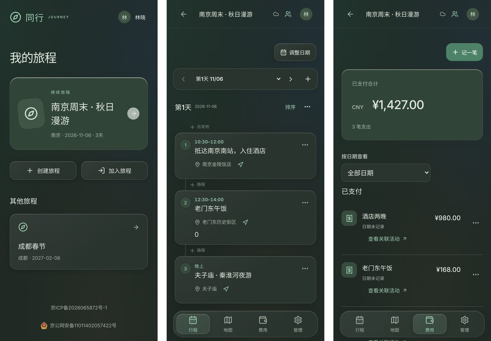

*手机暗色：整体协调，日期条和底栏的选中态偏弱。*

## iOS / Android 原生端

依据 10-31 的 iOS 26 Liquid Glass 截图和 Android 亮暗色主题截图，以及 Swift / Kotlin 主题源码。

### N-1　每张卡片都有 2–3 个玻璃胶囊按钮，“表态”含义不清

**N-1 · P1**　｜　平台：iOS

- 行程和费用的每张卡片底部都有「···」「💬 表态」，行程卡片还有「前往这一站」。十张卡片就是二三十个玻璃胶囊，视觉重量全压在操作上。
- “表态”是团队内部的设计术语，用户看不出点了会发生什么（实际是“不参加 / 希望删除”）。
- 胶囊里图标在最左、文字在最右，中间空一大段，像没对齐。
- “前往这一站”的路程信息放在卡片内部底部，而它描述的是两张卡片之间的关系。

**建议**

卡片本身不放按钮：点卡片进编辑，长按用系统 `.contextMenu`（编辑 / 地图 / 我不参加 / 希望删除 / 删除），左滑用 `.swipeActions` 删除。表态结果用一个小标签展示（“1 人不参加”）。路程放在卡片之间的连接线上，和 Web 一致。

### N-2　四个标签页的标题样式各不相同

**N-2 · P2**　｜　平台：iOS

行程页是居中的小标题（旅程名）+ 排序 + 黑色 ＋；地图页是居中小标题“沿途地图”+ 搜索；费用和管理页是左对齐大标题。首页下半屏留白，“已同步”是浮在左下的一个小字。另外亮色下的 ＋ 按钮几乎是黑色，比主题主色 `#3A6B5A` 深很多，像一个黑点。

**建议**

四个标签页统一用 `.navigationTitle` 大标题（行程 / 地图 / 费用 / 管理），旅程名放在大标题下方作为副标题或放在返回按钮旁边；主要操作按钮统一着色为 `Palette.primary`。

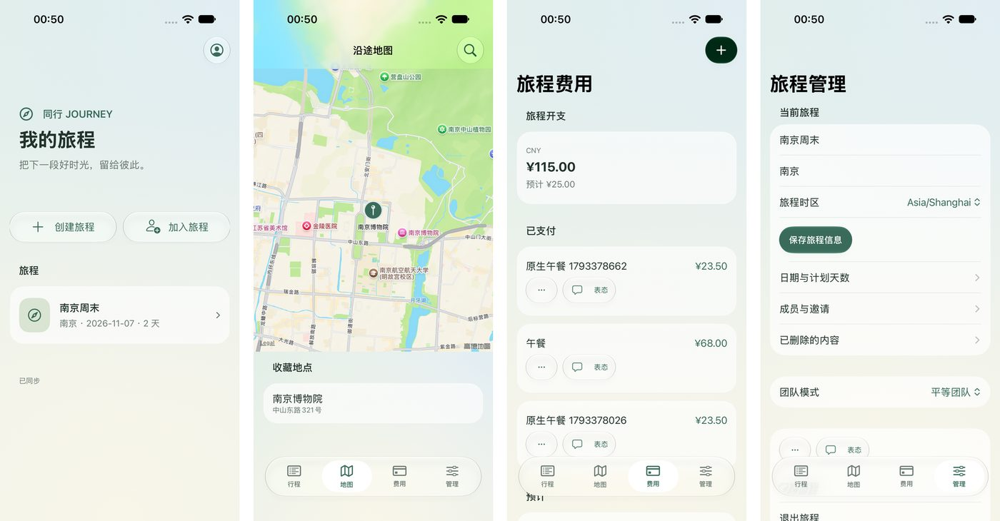

*iOS 亮色：首页、地图、费用、管理，标题样式不统一，每行费用都有两个胶囊按钮。*

### N-3　Android 的信息架构仍是早期版本

**N-3 · P1**　｜　平台：Android

- **每页顶部都有“已同步 · 刷新”一整行**（约 56dp），再加上“一起走过的每一天”“旅途花费 / 每一笔，一起记。”这类大号宣传语，首屏 1/4 被占用。网页端已经删掉了重复的大标题（M3），Android 没有跟上。
- **排序用“上移 / 下移”文字按钮**，网页和 iOS 都已经是拖动。
- **编辑器**：日期和时间做成了居中文字的描边胶囊（“安排日期：2026-11-07”），看起来像按钮而不是表单字段；“时段”是自由文本框（“如 上午”），而网页是“清晨 / 上午 / 中午…”的固定选项，会产生三端不一致的数据；地点搜索下方单独一个禁用状态的“搜索”小按钮。
- **费用**：金额在标题下方左对齐，不利于纵向比较；“预计”单独一行纯文本。
- **“管理”页图标**：是两个人（像“成员”），网页是齿轮，iOS 是滑块。

**建议**

- 同步状态放进 TopAppBar 右侧图标（正常时为云朵，异常时为带感叹号的云朵加文字），刷新改为下拉刷新（`PullToRefreshBox`）。
- 删掉宣传语，用 Material 3 的 `LargeTopAppBar` 显示“行程 / 费用”，旅程名放在副标题。
- 排序改用长按拖动（例如 `sh.calvin.reorderable`），与另外两端一致。
- 编辑器改为“标签在左、值在右”的列表行（参考 iOS 的 Form），日期、时间行点开原生 DatePicker / TimePicker；时段用 `SegmentedButton` 或下拉，选项与网页相同；搜索改为输入框尾部图标并响应输入法“搜索”键。
- 费用行：标题和金额同一行，金额右对齐、等宽数字；“预计”用小标签。

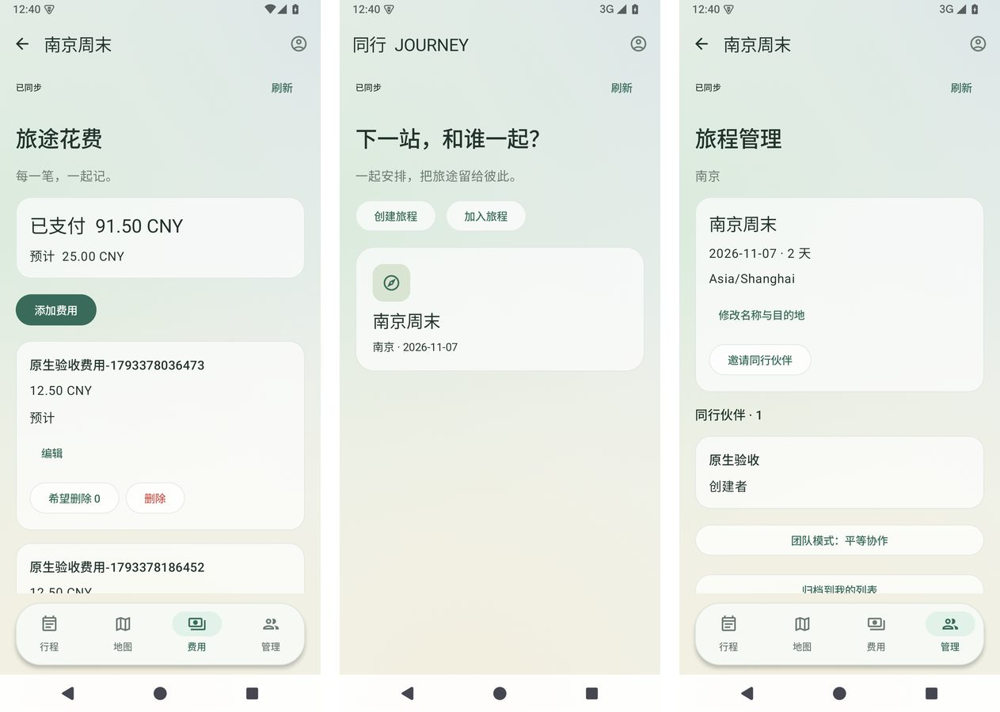

*Android 亮色：费用、首页、管理，顶部同步条和宣传语占用了大量首屏空间。*

## 跨端一致性

平台差异可以保留（导航形式、日期选择器、弹层样式），但同一功能的规则、位置和措辞应该相同。

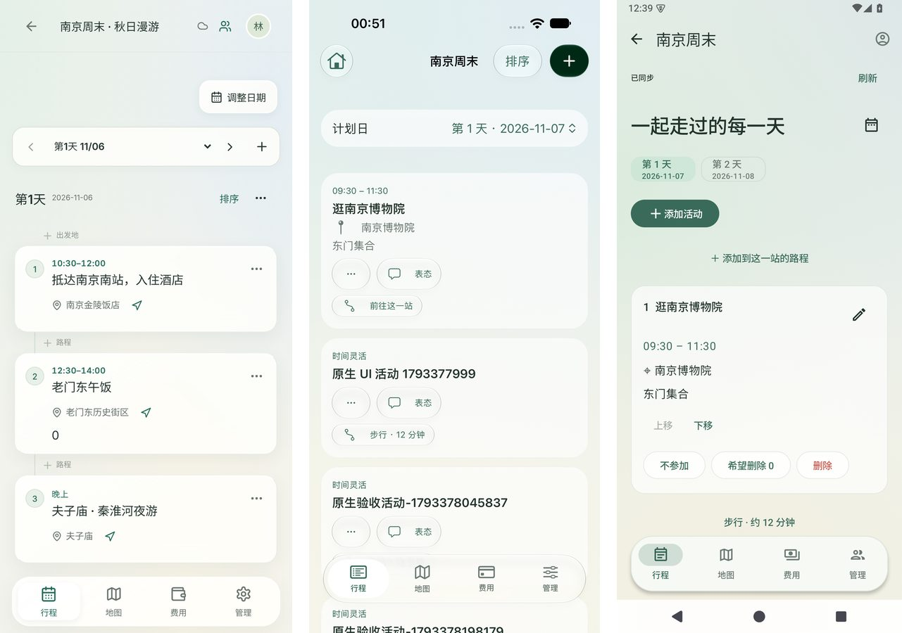

*同一天行程：Web 手机（左）、iOS（中）、Android（右）。卡片结构、操作入口、日期切换和路程展示都不一样。*

| 项目           | Web              | iOS              | Android                   | 建议统一为                |
|----------------|------------------|------------------|---------------------------|---------------------------|
| 保存方式       | 自动保存 + 完成  | 取消 / 保存      | ✕ + 底部保存              | 自动保存 + 完成（P0-3）   |
| 删除入口       | ··· 菜单 + 撤销  | ··· 菜单         | 卡片上的红色按钮          | 菜单 + 撤销（P0-4）       |
| 表态入口       | ··· 菜单         | “表态”按钮       | “不参加 / 希望删除 0”按钮 | 菜单内，结果用标签显示    |
| 排序           | 排序模式 + 拖动  | 编辑模式拖动     | 上移 / 下移               | 排序模式 + 拖动           |
| 备注显示       | 不显示           | 显示             | 显示                      | 单行显示                  |
| 时段           | 固定选项         | 固定选项         | 自由文本                  | 固定选项                  |
| “管理”图标     | 齿轮             | 滑块             | 两个人                    | 滑块或齿轮，三端相同      |
| 主色（亮）     | `#246b58`        | `#3A6B5A`        | `#3A6B5A`                 | 一个值                    |
| 页面底色（亮） | `#f3f3ed`        | `#EEF2EC`        | `#EEF2EC`                 | 一个值                    |
| 暗色主按钮     | 白字 / `#4d8268` | 深字 / `#7FCBA5` | 深字 / `#7FCBA5`          | 深字 / 浅绿（对比度更高） |
| 危险色（亮）   | `#a63731`        | `#C9594F`        | `#C9594F`                 | 一个值，≥4.5:1            |

**建议：一份 token 文件生成三端主题**

在仓库根目录建 `design/tokens.json`，用一个几十行的 Node 脚本（或 Style Dictionary）生成 `tokens.css`、`Theme.swift`、`Theme.kt`。以后调色只改一处，三端自动一致，也正好解决你们之前“手机端暗色不好看”时需要两边分别调的问题。

```json
{
  "color": {
    "primary":   { "light": "#2f6b57", "dark": "#8fcbb0" },
    "onPrimary": { "light": "#ffffff", "dark": "#10221a" },
    "page":      { "light": "#f1f2ec", "dark": "#121815" },
    "surface":   { "light": "#fffefa", "dark": "#1c2621" },
    "text":      { "light": "#22302a", "dark": "#e4ebe6" },
    "muted":     { "light": "#5e6a63", "dark": "#a3b0a8" },
    "danger":    { "light": "#b0443a", "dark": "#f09684" }
  },
  "radius": { "sm": 8, "md": 12, "lg": 16, "xl": 24 },
  "font":   { "caption": 12, "meta": 13, "body": 15, "title": 17, "section": 20, "page": 28 }
}
```

## 建议的修改顺序

按“影响大、改动小”排序。前三步大约一天能完成。

1.  **修两个 bug统一保存与删除规则建 token，替换字号和颜色手机行程页做减法收敛材质Android 追平费用页和首页增强细节打磨**F-3、F-4、F-6、F-8、F-9、N-1、N-2、V-5、V-6。

如果是课程答辩，第 1–4 步做完后再截一轮三端对比图，前后对比本身就是很好的 HCI 迭代证据。

