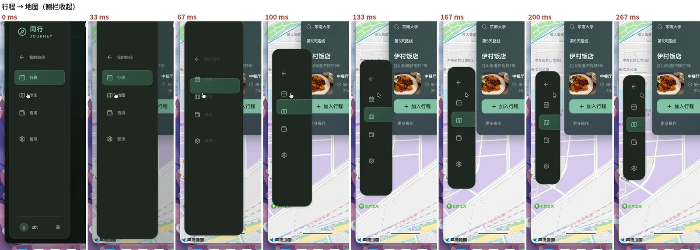
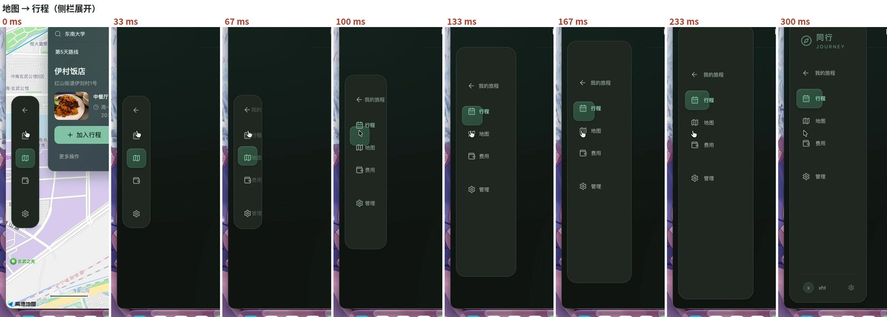
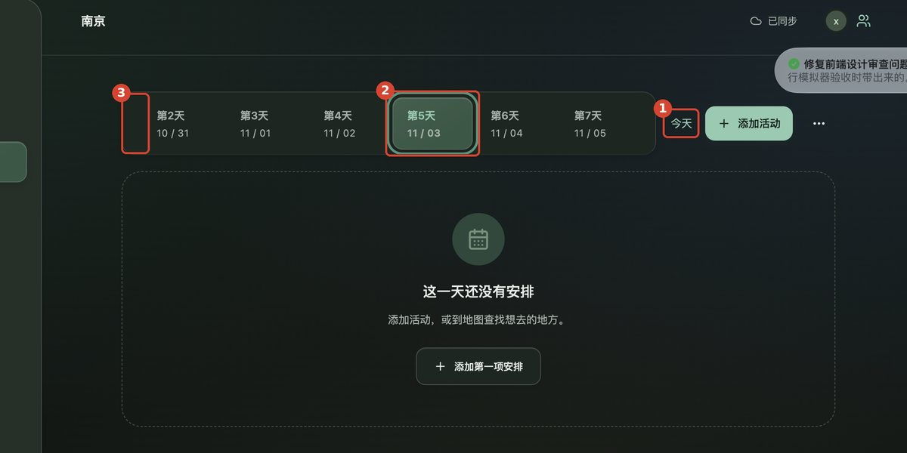
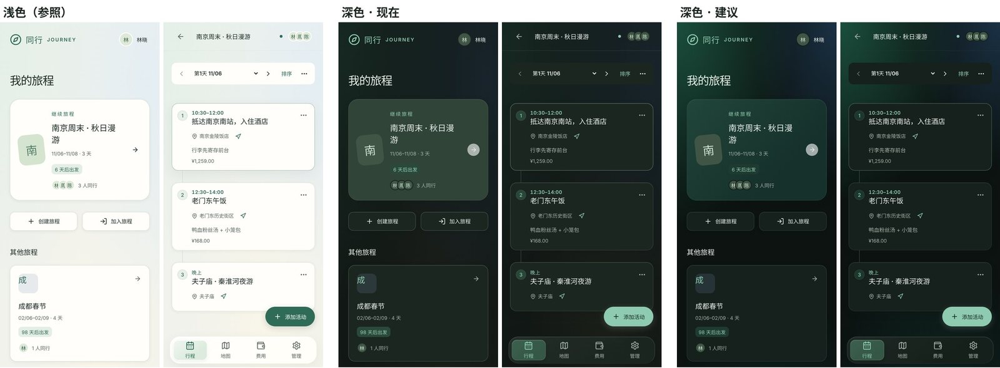
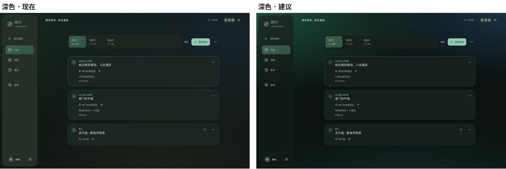
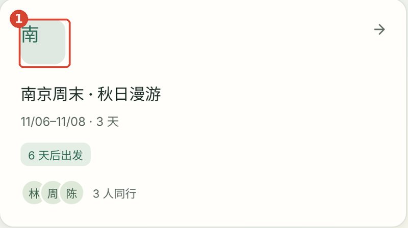
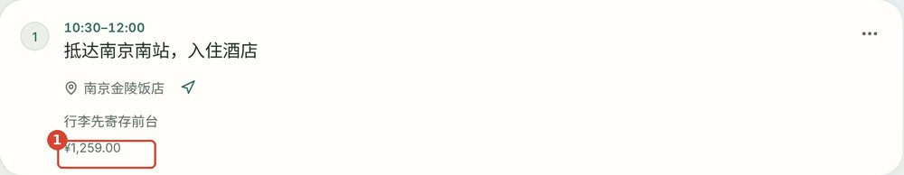
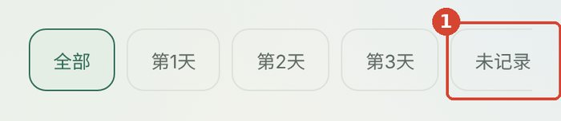
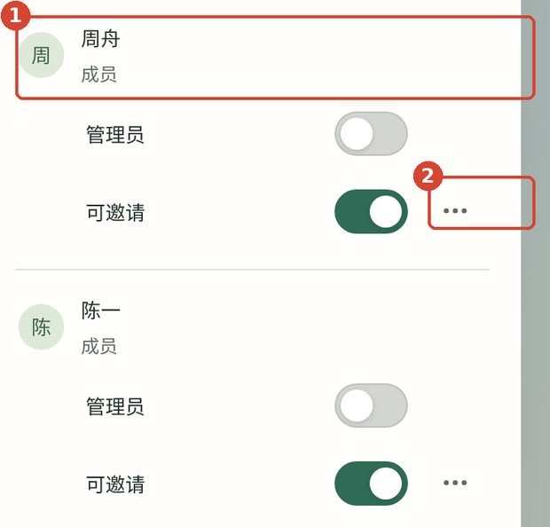

# 「同行 Journey」前端复查与修改建议（第三轮）

> 日期：2026-11-01　｜　接续：[前端设计审查-2026-10-31](../2026-10-31-前端设计审查/前端设计审查-2026-10-31.md)、[2026-10-31 前端设计审查修复](../../实施记录/2026-10-31-前端设计审查修复.md)
>
> 复查对象：`dev` 分支 `3d227d9` 至 `a588ef6`，网页使用 10-31 23:08 的 `app/dist` 构建。

## 范围与方法

- **网页端**：本地启动服务，使用 3 人、3 天的南京样例旅程，在 1440px 桌面和 390px 手机的亮色与暗色模式下逐页截图，并对照源码。
- **侧栏动画**：使用产品负责人提供的录屏（`录屏2026-11-01_00_10_26.mov`，60fps）逐帧拆解。
- **原生端**：本轮 iOS 模拟器测试宿主启动失败，Android 未在设备上运行，没有新的界面截图，因此只核对了代码。
- **本地限制**：没有高德 Key，地图底图未渲染。地图页只检查控件、失败态和侧栏动画。

## 本轮要处理的问题

| 编号 | 问题 | 优先级 | 涉及 |
| --- | --- | --- | --- |
| R3-1 | 进出地图时，侧栏收起和展开的各部分动画不同步 | P1 | Web 桌面 |
| R3-2 | 行程页「今天」入口样式突兀，当天日期在标签上没有标记 | P1 | Web 桌面 / 手机 |
| R3-3 | 深色模式渐变发灰发脏，需要迭代色彩 | P1 | Web / iOS / Android |
| R3-4 | 头像叠放时遮住姓氏，“周”看起来像“禹” | P1 | Web |
| R3-5 | 首页普通旅程卡片的目的地字没有居中 | P2 | Web |
| R3-6 | 继续旅程卡片的标题末尾单字换行 | P2 | Web 手机 |
| R3-7 | 活动卡片里的关联费用没有说明 | P2 | Web |
| R3-8 | 日期标签条：桌面空白多、溢出无提示、选中项多一圈描边 | P2 | Web 桌面 |
| R3-9 | 费用页日期筛选标签溢出，没有可滑动的提示 | P2 | Web 手机 |
| R3-10 | 团队弹窗里成员的「···」位置错位 | P2 | Web |
| R3-11 | 手机顶栏的同步状态只剩一个绿点 | P3 | Web 手机 |
| R3-12 | 原生端缺少本轮的界面验收截图 | P1 | iOS / Android |

---

## 一、上一轮修复的复查结果

| 上一轮编号 | 复查结果 |
| --- | --- |
| P0-1 孤立的“0” | 已修复，网页实测不再出现。 |
| P0-2 iOS 保存按钮折行 | 代码已改为「完成」并加 `.lineLimit(1).fixedSize()`。没有新截图，未目测确认。 |
| P0-3 三端保存规则 | 代码已统一为自动保存 + 完成。原生端未目测确认。 |
| P0-4 Android 删除外露 | 代码已改用 `DropdownMenu`，删除放在最后。未目测确认。 |
| F-1 行程页顶部 | 已修复。日期与排序合并为一行，手机有「添加活动」悬浮按钮，首屏多出约一张卡片。 |
| F-2 卡片信息 | 已修复，备注和关联费用都会显示。关联费用缺少说明，见 R3-7。 |
| F-3 拖动柄规则 | 已修复，排序模式下具体时间的活动显示锁。 |
| F-4 更多菜单 | 已修复，加了图标，删除放在最后并有分隔线。 |
| F-5 费用页 | 已修复日期分组、筛选标签、人均和币种重复。付款人与分类按计划留到后续版本。筛选标签有新问题，见 R3-9。 |
| F-6 编辑器 | 已修复，手机单列，名称为空时「完成」禁用，折叠箭头统一。 |
| F-7 首页 | 已修复，卡片显示日期范围、出发倒计时、成员和目的地色块。新问题见 R3-4、R3-5、R3-6。 |
| F-8 团队与同步 | 已修复，权限改为开关，平等团队有说明，已同步时显示「立即同步」。新问题见 R3-10。 |
| F-9 地图失败态 | 已修复，无效控件隐藏，列出当天地点和收藏。 |
| V-1 至 V-6 | 字号、圆角和颜色 token 已落地，暗色主按钮改为浅绿底深色字。仍有写死的颜色，见 R3-3。 |

---

## 二、产品负责人指出的两个问题

### R3-1　进出地图时侧栏动画不同步（P1）

**现象**

下面两组图按 33ms 间隔逐帧截取（录屏为 60fps，取偶数帧）：





收起时（行程 → 地图）：

1. **0–33ms**：品牌标识和底部头像在一帧内直接消失，没有过渡。
2. **67ms**：文字开始淡出，但面板仍是原来的宽度，选中底板开始从「行程」滑向「地图」。
3. **100–200ms**：面板已经收窄到约 72px，选中底板却还是宽的，从面板右侧伸到了地图上，之后才慢慢缩回。
4. **全程**：面板高度从全屏收缩到 342px，并以屏幕中线为基准重新居中。图标因此先往下移、再往上移，纵向移动了约 90px。
5. 地图内容在第一帧就整块出现，而侧栏还在变形，两者没有任何衔接。

展开时（地图 → 行程）：

1. 行程页内容在第一帧就替换了地图，侧栏还是窄条。
2. 面板还没变宽，文字就已经淡入，“我的旅程”“行程”等字溢出到面板外面。
3. 选中底板停留在图标大小，等面板展开后才变宽。
4. 品牌和底部头像在 240ms 延迟后突然出现。

**原因**（`app/src/navigation.css`、`components/SelectionTrack.jsx`）

| 部件 | 当前时长 | 问题 |
| --- | --- | --- |
| 面板宽高、圆角 | 300ms | 用 `top:50%` 加 `translateY(-50%)` 居中，高度变化时面板会上下漂移 |
| 导航区位置 `top/left/right` | 300ms | 从 `top:108px` 移到 `top:11px`，与面板居中叠加，导致图标上下移动 |
| 按钮内边距、间距 | 300ms | 与面板同步，但文字没有裁切 |
| 文字透明度 | 140ms，收起和展开都没有延迟 | 展开时文字在面板变宽之前出现 |
| 品牌、底部头像 | 收起时 `visibility` 0s；展开时延迟 240ms 后 120ms | 收起是瞬间消失，展开是突然出现 |
| 选中底板 | 260ms，由 `ResizeObserver` 每帧重新设目标 | 一直在追赶不断变化的按钮尺寸，所以落后并溢出面板 |
| 主内容（地图 / 行程） | 无过渡 | 第一帧就切换，与侧栏动画脱节 |

另外，宽高动画每帧都会触发重新布局。如果这时高德地图正在初始化、占用主线程，就会丢帧，录屏里 300ms 的动画实际只渲染了 5–6 帧。

**修改方案**

总原则：**以图标为锚点**。收起和展开时，图标的位置基本不动，只是面板的四边向图标收拢或从图标展开；文字先淡出再收，先展开再淡入。

1. **统一时间线**。面板、导航区和按钮内边距使用同一个时长和缓动：

```css
:root { --nav-dur: 280ms; --nav-ease: cubic-bezier(.3, 0, .2, 1); }
```

2. **收起后不再垂直居中**。收起态的面板顶部对齐展开态导航区的顶部，图标的纵坐标保持不变：

```css
@media (min-width: 761px) {
  .app-shell > .sidebar { top: 14px; transform: none; }
  :root:not([data-map-sidebar-collapse='false']) .map-shell > .sidebar {
    top: calc(14px + 108px - 11px);   /* 展开态导航顶部 − 收起态内边距 */
    height: auto;                      /* 由导航内容决定，不再写死 342px */
  }
  :root:not([data-map-sidebar-collapse='false']) .map-shell .sidebar-navigation { top: 11px; }
}
```

上面的数字只是示意，实现时以“收起前后图标纵坐标差 ≤ 4px”为准微调。面板的高度改为由内容撑开后，`height` 无法直接做过渡，可以选下面两种做法之一：
- 用 `clip-path: inset(... round 22px)` 做形状动画。这只触发合成，不触发布局，也能顺带解决地图初始化时的掉帧。推荐这种。
- 在 JS 里先读出目标高度，再写成具体像素值来做过渡。

3. **文字先淡出、后淡入**。过渡规则写在“目标状态”上，收起和展开就能使用不同的延迟：

```css
/* 展开态（默认）：等面板展开到一半以上再淡入 */
.app-shell .sidebar nav button > span,
.app-shell .sidebar .back-home > span {
  opacity: 1;
  transition: opacity 120ms ease 160ms;
}
/* 收起态：立即淡出，100ms 内完成 */
:root:not([data-map-sidebar-collapse='false']) .map-shell .sidebar nav button > span,
:root:not([data-map-sidebar-collapse='false']) .map-shell .sidebar .back-home > span {
  opacity: 0;
  transition: opacity 100ms ease 0s;
}
/* 任何时候文字都不能溢出按钮 */
.app-shell .sidebar nav button,
.app-shell .sidebar .back-home { overflow: hidden; white-space: nowrap; }
```

4. **品牌和底部头像同样处理**，用透明度过渡，不再让 `visibility` 直接切换：

```css
.app-shell .sidebar > .brand,
.app-shell .sidebar-foot {
  opacity: 1; visibility: visible;
  transition: opacity 140ms ease 140ms, visibility 0s linear 0s;
}
:root:not([data-map-sidebar-collapse='false']) .map-shell .sidebar > .brand,
:root:not([data-map-sidebar-collapse='false']) .map-shell .sidebar-foot {
  opacity: 0; visibility: hidden;
  transition: opacity 80ms ease 0s, visibility 0s linear 80ms;
}
```

5. **侧栏变形期间，选中底板直接跟随按钮**。在侧栏的 `transitionrun` / `transitionend` 事件上切换一个标记，变形期间关闭底板自身的过渡。这样 `ResizeObserver` 每帧量到的尺寸会立即生效，底板会贴着按钮一起变形：

```js
// App.jsx 或 SelectionTrack 所在的侧栏组件
const sidebar = sidebarRef.current;
const start = (e) => { if (e.target === sidebar) sidebar.dataset.resizing = ''; };
const end   = (e) => { if (e.target === sidebar) delete sidebar.dataset.resizing; };
sidebar.addEventListener('transitionrun', start);
sidebar.addEventListener('transitionend', end);
sidebar.addEventListener('transitioncancel', end);
```

```css
.sidebar[data-resizing] .selection-indicator { transition: none; }
```

切换到地图时，底板会直接出现在「地图」上，不再从「行程」滑过去。侧栏本身在变形，所以这一瞬的跳转不会显得突兀，也能马上反馈“我点的是地图”。

6. **主内容与侧栏衔接**。地图层在侧栏收起后（或同时）用 160–200ms 淡入，离开地图时行程内容也淡入，不要在第一帧整块替换。高德地图的初始化放到侧栏 `transitionend` 之后，或用 `requestIdleCallback` 推迟，避免它在动画期间占用主线程。

7. 开启“减少动态效果”时，以上动画全部直接切换（现有的全局规则已覆盖，改完后复测一次）。

**验收标准**（用 60fps 录屏逐帧检查）

- 任何一帧里，文字都不超出面板边缘，选中底板也不超出面板边缘。
- 收起和展开过程中，每个图标的横向、纵向位移都 ≤ 6px。
- 品牌、头像、文字都没有在单帧内出现或消失的情况（减少动态效果模式除外）。
- 整个过程 ≤ 300ms，渲染帧数 ≥ 15 帧（60Hz 下）。
- 地图页和行程页来回切换 5 次，表现一致；中途反向点击（动画进行中再点回行程）也不错位。

---

### R3-2　行程页「今天」入口样式突兀（P1）



*① 「今天」 ② 选中项外圈多了一道描边（见 R3-8） ③ 第 1 天被滚出可视区，没有任何提示（见 R3-8）*

**现象与原因**

- 「今天」是一个没有底色、没有边框的文字按钮（`Itinerary.jsx` 里的 `.text-button`），左边是带玻璃底板的日期标签条，右边是实心的主按钮。一行里出现了三种完全不同的视觉语言，它的高度（约 40px）和基线也与两侧对不齐。
- 字面上读起来像一个标签或状态，看不出是“跳到今天”这个动作。
- 桌面端的日期标签上**没有标记哪一天是今天**（只有手机端下拉选项里有“· 今天”）。在截图里，今天是第 3 天（11/01），但标签上看不出来；点了「今天」之后，用户也无法从标签确认自己跳到了哪一天。
- 「下一项」也是同样的文字按钮，旅途中两个会挤在一起。

**修改方案**

1. **在日期标签上标记今天**：今天那一天的标签，把日期换成“今天”，用主色加粗，右上角加一个 6px 的主色圆点。无论当前选中哪一天，都能一眼看到今天的位置。

```jsx
<button className={`${selected ? 'selected' : ''} ${d.payload.date === today ? 'is-today' : ''}`}>
  <strong>{dayLabel(d)}</strong>
  <small>{d.payload.date === today ? '今天' : formatMonthDay(d.payload.date)}</small>
</button>
```

```css
.day-tabs button.is-today small { color: var(--accent); font-weight: 600; }
.day-tabs button.is-today::before {
  content: ""; position: absolute; top: 8px; right: 8px;
  width: 6px; height: 6px; border-radius: 50%; background: var(--accent);
}
```

2. **跳转入口改成与周围一致的次要按钮**，带图标，高度与日期标签内的按钮对齐，只在“今天在行程范围内且当前没有选中今天”时出现：

```jsx
<button className="day-jump" onClick={goToday}>
  <LocateFixed size={16} /> 回到今天
</button>
{nextActivity && (
  <button className="day-jump" onClick={showNext}>
    <ArrowDownToLine size={16} /> 下一项 {nextActivity.time}
  </button>
)}
```

```css
.day-jump {
  display: inline-flex; align-items: center; gap: 6px;
  height: 40px; padding: 0 14px;
  border-radius: var(--radius-md);
  border: 1px solid var(--line);
  background: var(--surface);
  color: var(--accent);
  font-size: var(--fs-meta); font-weight: 500;
}
.day-jump:hover { background: var(--accent-soft); }
```

3. **位置**：把「回到今天」「下一项」放在日期标签条的**左侧**或标签条下方单独一行，与「排序 / 添加活动 / ···」这组编辑操作分开。前两者是“浏览”，后三者是“编辑”，两类操作不应挤在一组里。
4. **手机端**：日期条下拉菜单顶部加一项“回到今天”，日期条右侧在不是今天时显示一个 32px 的圆形定位图标按钮，不再显示文字。

**验收**：深色和浅色下，「回到今天」与「添加活动」的高度、圆角一致；今天的标签无论是否选中都能识别；点击后目标标签滚动到可视区中央。

---

## 三、深色模式色彩迭代

### R3-3　深色渐变发灰发脏（P1）





*右侧“建议”是在本地页面临时注入 CSS 得到的效果，没有修改仓库代码。*

**原因**

1. **光晕太暗，看起来像污渍而不是光**。浅色模式的三团渐变是很淡的薄荷、天蓝和米白，铺在接近白色的底上，读起来像透过玻璃的日光。深色沿用了同样的结构，但颜色又暗、透明度又低：光晕处的亮度只比底色高 2–4 个 L\* 单位（约从 9 提到 11–13）。在这么低的亮度下，人眼几乎分辨不出色相，看到的是一块块发灰的斑。
2. **暖色光晕在深绿底上变成了土黄色**。暖色在深色下的值是 `#4d45322b`（网页），iOS 是 `Palette.warm` 的 `0x1A1D14`，Android 是 `ambientBottom = 0xFF1A1D14`。它们叠在墨绿上发黄发褐，页面底部因此显得脏。
3. **还有写死的橄榄色绕过了 token**。它们都比底色和主色更偏黄，让整页往橄榄色走：

| 位置（`app/src/styles.css`） | 当前值 | 用途 |
| --- | --- | --- |
| 1731、1766 行 | `#252f28` | 深色侧栏 |
| 1743、1778 行 | `#314438` | 深色继续旅程卡片、费用总额卡 |
| 1753、1788 行 | `#405546` | 深色头像、品牌图标底、旅程色块 |

4. **渐变的形状照搬了浅色**（椭圆到 50% 就透明），在深色下光晕范围太小，只剩角落里几块。

**修改方案**

总原则：深色渐变要做成“夜里的光源”，而不是把浅色调暗。只保留翡翠绿和青蓝两种冷色，去掉暖黄；光晕要明显提亮、范围加大；表面统一用偏冷的墨绿，不再出现偏黄的橄榄色。

**1. `design/tokens.json` 深色值修改**

| token | 当前深色值 | 建议深色值 | 说明 |
| --- | --- | --- | --- |
| `color.page` | `#121815` | `#0c1311` | 底色压暗一点，给光晕留出亮度空间 |
| `color.surface` | `#1c2621` | `#16201c` | 卡片改为偏冷的墨绿 |
| `web.glass` | `#1c2621eb` | `#16201ceb` | 跟随 surface |
| `web.line` | `#435047` | `#2c3a34` | 边线更安静 |
| `web.accent-soft` | `#2b493b` | `#1f3a30` | 去掉偏黄成分 |
| `web.ambient-mint` | `#214d424b` | `#2ea0786b` | 左上翡翠光，提亮并提高透明度 |
| `web.ambient-sky` | `#253f5c4f` | `#3c76be4d` | 右上青蓝光 |
| `web.ambient-warm` | `#4d45322b` | `#1870683d` | 改为底部深青，不再用暖黄。建议把键名改为 `ambient-low` |
| `web.optical-panel` | `#2d3b35b8` | `#121b18d9` | 侧栏玻璃，去掉橄榄色 |

浅色值不变。

**2. 深色背景渐变的形状**（`styles.css` 约 2790 行，只覆盖深色）

```css
:root[data-theme='dark'] :is(body:has(> .site-filing), .app-shell:not(.map-shell), .home, .auth-page) {
  background:
    radial-gradient(120% 85% at 0% 0%,    var(--ambient-mint), transparent 62%),
    radial-gradient(90% 70% at 100% 0%,   var(--ambient-sky),  transparent 60%),
    radial-gradient(100% 60% at 60% 112%, var(--ambient-warm), transparent 70%),
    var(--bg);
}
/* 跟随系统的暗色分支需要同样的一份，建议由生成脚本输出，避免手写两份 */
```

**3. 删除写死的橄榄色，改用 token**

```css
:root[data-theme='dark'] .app-shell > .sidebar {
  background: linear-gradient(160deg, var(--optical-sheen), transparent 45%), var(--optical-panel);
}
:root[data-theme='dark'] .continue-card,
:root[data-theme='dark'] .ledger-total {
  background: linear-gradient(135deg, #21463a, #16302b 70%);   /* 可新增 token：hero-surface */
}
:root[data-theme='dark'] .avatar,
:root[data-theme='dark'] .trip-art,
:root[data-theme='dark'] .brand-mark {
  background: #2a4a3e; color: #cfe7da;                         /* 可新增 token：avatar-bg / avatar-fg */
}
```

**4. 原生端同步**

目前环境光只存在于 `tokens.json` 的 `web` 分组中，原生端的值是在 `Theme.swift` 和 `Theme.kt` 里手写的。建议把 `ambient-mint`、`ambient-sky`、`ambient-low` 挪到共享的 `color` 分组，由 `scripts/generate-design-tokens.mjs` 同时生成 Swift 和 Kotlin：

| 平台 | 位置 | 当前深色值 | 建议 |
| --- | --- | --- | --- |
| iOS | `Theme.swift` 第 32 行 `Palette.warm` | `0x1A1D14` | 改为 `ambient-low`（深青），并把三个 `RadialGradient` 的半径同步放大 |
| Android | `Theme.kt` 第 72–74 行 `ambientTop / ambientBottom / ambientMint` | `0xFF14201F / 0xFF1A1D14 / 0xFF142219` | 改由生成文件提供，`ambientBottom` 改为深青 |

**5. 对比度核对**（建议值，均满足 WCAG AA）

| 前景 / 背景 | 对比度 |
| --- | --- |
| 正文 `#e4ebe6` / 卡片 `#16201c` | 13.8 : 1 |
| 次要文字 `#a3b0a8` / 卡片 `#16201c` | 7.4 : 1 |
| 次要文字 `#a3b0a8` / 底色 `#0c1311` | 8.4 : 1 |
| 主色 `#8fcbb0` / 卡片 `#16201c` | 9.0 : 1 |
| 主色 `#8fcbb0` / `accent-soft` `#1f3a30` | 6.6 : 1 |
| 头像字 `#cfe7da` / 头像底 `#2a4a3e` | 7.5 : 1 |
| 主按钮字 `#10221a` / 主按钮 `#8fcbb0` | 9.0 : 1 |

**验收**：深色下截取首页、行程、费用、管理四页的桌面和手机截图，与浅色并排放在一起。要求页面任何位置都看不到黄褐或橄榄色的区域；左上和右上的光晕在普通亮度的屏幕上肉眼可见；卡片与底色的层次清楚。改完后跑 `npm run tokens:check`，iOS 和 Android 各截一张首页深色图作为证据。

---

## 四、新发现的问题

### R3-4　头像叠放时遮住姓氏（P1）


头像之间重叠了约 9px，后一个头像会盖住前一个头像里汉字的右半边。在手机顶栏（约 24px 的头像）和首页卡片上，“周”的右半边被挡住后，看起来像“禹”。英文首字母很窄，所以这种重叠在英文界面上没问题，但汉字是方块字，经不起遮挡。

**修改**：重叠量减到 4–5px，每个头像加一圈 2px 的 `var(--surface)` 描边，并让前面的头像压在后面的上方（`z-index` 递减），这样被遮住的只是圆形底色，不会遮到字：

```css
.avatar-stack .avatar { margin-left: -5px; box-shadow: 0 0 0 2px var(--surface); }
.avatar-stack .avatar:nth-child(1) { z-index: 3; }
.avatar-stack .avatar:nth-child(2) { z-index: 2; }
.avatar-stack .avatar:nth-child(3) { z-index: 1; }
```

手机顶栏空间不够时，只显示第一个头像加“+2”。

### R3-5　首页普通旅程卡片的目的地字没有居中（P2）



“继续旅程”卡片里的“南”是居中的，普通旅程卡片色块里的“南 / 成”却贴在左上角。给色块加 `display: grid; place-items: center;`，字号用 `var(--fs-section)`。

### R3-6　继续旅程卡片的标题末尾单字换行（P2）


390px 下，标题折成了“南京周末 · 秋日漫 / 游”，最后一个字单独占一行。给标题加 `text-wrap: pretty;`（Safari 17.4+ / Chrome 117+ 支持，不支持的浏览器自动忽略），或把左侧色块缩小到 56px。

### R3-7　活动卡片里的关联费用没有说明（P2）



卡片底部只有“¥1,259.00”，容易被理解成门票价格或预算。改成“钱包图标 + 已付 ¥1,259 · 2 笔”；如果只有预计金额，写“预计 ¥60”。点击后跳到费用页并筛选出这项活动关联的费用。

### R3-8　日期标签条：桌面空白多、溢出没有提示、选中项多一圈描边（P2）


1. **桌面空白**：只有 3 天时，标签条也被拉满整行，右侧是一大块空玻璃（上图 ①）。改成 `width: max-content; max-width: 100%;`。
2. **溢出没有提示**：天数多时，标签条会横向滚动，但两端没有任何提示。R3-2 的截图里，第 1 天已经被滚出可视区，用户无从得知（图 ③）。建议给标签条加两端的渐隐遮罩，桌面端在两端显示 ‹ › 按钮：

```css
.day-tabs.is-overflowing {
  mask-image: linear-gradient(90deg, transparent 0, #000 24px, #000 calc(100% - 24px), transparent 100%);
}
```

3. **选中项多一圈描边**：R3-2 截图里第 5 天外面有一圈很粗的主色描边，叠在选中底板外面，像双重边框（图 ②）。这应该是焦点环和选中样式叠加了。焦点环只在 `:focus-visible` 时出现，改成向内偏移（`outline-offset: -2px`），2px 宽；代码切换日期时，不要把焦点移到按钮上。

### R3-9　费用页日期筛选标签溢出（P2）



手机上，“未记录”标签被截了一半，又没有可横向滑动的提示。处理方式同 R3-8：加渐隐遮罩，并在选中标签时把它自动滚动到可视区。

### R3-10　团队弹窗里成员的「···」位置错位（P2）



「···」（移除成员）放在了“可邀请”开关那一行（图 ②），看起来像是“可邀请”这个开关的更多选项。它是针对整个成员的操作，应该放在成员名字那一行的最右侧（图 ①）。

### R3-11　手机顶栏的同步状态只剩一个绿点（P3）

已同步时，顶栏只有一个 6px 的绿点，第一次看到的用户不知道它表示什么，容易误解成“在线”。建议改为一个 16px 的小云朵加对勾图标，并加 `aria-label="已同步，查看保存与同步"`；异常时保留现有的文字提示。

### R3-12　原生端缺少本轮界面验收（P1，流程）

本轮 iOS 模拟器测试宿主启动失败（CoreSimulator 405），Android 没有在设备上运行。P0-2、P0-3、P0-4、N-1 至 N-3 都只在代码层面完成，没有界面证据。合并 `main` 之前，iOS 和 Android 各补一轮亮暗色截图：首页、行程、地图、费用、管理、活动编辑器，共 12 张。重点确认：保存按钮不折行、删除收在菜单里、深色没有黄褐色区域。

---

## 五、建议的处理顺序

1. **R3-4、R3-5、R3-6、R3-7**：都是一两行 CSS 或文案改动，半天内可以完成。
2. **R3-3 深色色彩**：先改 `tokens.json` 和生成脚本，再删除写死的颜色，最后同步原生端。
3. **R3-2「今天」入口**和 **R3-8 日期标签条**：两者改的是同一块区域，一起处理。
4. **R3-1 侧栏动画**：改动最大，建议单独一个提交，并附上改前和改后的 60fps 录屏。
5. **R3-9、R3-10、R3-11**：顺手处理。
6. **R3-12 原生截图验收**：合并 `main` 前完成。

## 六、验收清单

- [ ] 侧栏收起和展开逐帧检查通过（R3-1 的 5 条标准）
- [ ] 今天的标签在桌面和手机上都能识别；「回到今天」与相邻按钮高度、圆角一致
- [ ] 深色四页截图里没有黄褐或橄榄色区域，光晕可见；`npm run tokens:check` 通过
- [ ] 头像里的汉字在 24px 尺寸下完整可读
- [ ] 首页色块字居中，继续旅程标题末尾不出现单字
- [ ] 活动卡片上的费用带有说明
- [ ] 日期标签条和费用筛选标签溢出时有提示，选中项没有双重描边
- [ ] 团队弹窗的「···」在成员名字那一行
- [ ] iOS 和 Android 亮暗色各 6 张截图归档到 `docs/实施记录/`
