# 「旅行图册」改版评估与绿 / 蓝双主题方案

> 日期：2026-11-01　｜　对比对象：`603a59d`（11-01 01:12，绿色版）与 `10d4dd2`（11-01 22:57，「旅行图册」蓝色改版）
>
> 相关文档：[09-旅行图册视觉重设计](../../设计文档/09-旅行图册视觉重设计.md)、[前端复查与修改建议-2026-11-01](../2026-11-01-前端复查与修改建议/前端复查与修改建议-2026-11-01.md)

## 结论

`10d4dd2` 紧接在 `603a59d` 之后，两者的差异就是这一个提交。`603a59d` 本身只归档了文档和截图，没有改界面代码。所以下面评估的就是 `10d4dd2` 这次改版。

改版里有三类东西混在一起：

1. **配色**：绿换成海图蓝。适合做成**可选主题**，但现在的写法是直接覆盖全局颜色，绿色已经选不回来了。
2. **结构上的界面优化**：日期标签条去外框、设置分组、费用分组、输入框底色、地图菜单不透明等。大部分是有效改进，**两个主题都应该保留**。
3. **装饰和字体**：重复的强调色竖条、改小的圆角、衬线标题字体、Manrope 字体。其中有两处**引入了新问题**（字重丢失、标题混字体），需要先修；其余意义不大，建议不保留，或者只留在蓝色主题里。

建议的落地方式：把配色挪进 `design/tokens.json`，作为“森林绿 / 海图蓝”两套调色板，由生成脚本同时输出网页、iOS 和 Android 的主题文件。结构优化并回共用样式；只属于图册风格的少量装饰，限定在蓝色主题下生效。

## 评估方法

- 在本地用 `10d4dd2` 之后的构建（11-01 23:07）启动服务，使用同一份 3 人南京样例旅程。
- “绿色版”是用同一份构建、去掉 `atlas.css` 那部分样式后渲染的。`10d4dd2` 里另外只有两处 JSX 改动：页面标题 `sr-only` 改为可见，以及登录插图。前者已用样式还原；后者没有还原，所以登录页左侧的插图两边是同一张新图。
- 1440px 桌面和 390px 手机，亮色和暗色，逐页截图；同时核对计算样式、字体加载情况和对比度。
- 首页截图有一处差异与改版无关：截绿色版时这个账号还没有“最近旅程”记录，所以绿色版没有继续旅程卡片。

---

## 一、改动清单与判断

`10d4dd2` 共改动 15 个文件：新增 `app/src/atlas.css`（837 行）和 2 个本地字体，`Login.jsx` 换了插图，`Itinerary / Ledger / Settings.jsx` 把页面标题从屏幕阅读器专用改为可见，另外是测试和设计文档。

### A. 配色：改成可选主题

| 改动 | 判断 | 说明 |
| --- | --- | --- |
| 浅色、深色全套颜色换成海图蓝（主色 `#176B88`、底色 `#EDF3F6`、深色底 `#102632`） | **保留，作为“海图蓝”主题** | 配色本身是成立的，深色版的对比度也够。问题在于它直接写在 `:root` 上，覆盖了 `tokens.css`，绿色因此完全消失 |
| 深色背景改为纯色（`--page-background: var(--bg)`） | **只用于蓝色主题** | 它同时也覆盖掉了上一轮刚做好的绿色深色渐变 |
| 头像、继续旅程卡片底色改为蓝色系 | **作为蓝色主题的 token** | `--avatar-bg / --avatar-fg / --hero-surface` 已经是 token，直接放进调色板即可 |
| 次要文字 `#5B7280` | **需要微调** | 在底色 `#EDF3F6` 上对比度正好 4.50，没有余量，放在浅蓝卡片底上会低于 4.5。建议改为 `#536A77`（5.07） |
| 只在网页生效，没有进入 `tokens.json` | **需要改** | 结果是网页变蓝、原生 App 仍是绿色，`npm run tokens:check` 也检查不到这部分 |

### B. 有效的界面优化：两个主题都保留

| 改动 | 为什么有效 |
| --- | --- |
| 日期标签条去掉玻璃外框，工具栏下方加一条分隔线 | 少了一层容器，也顺带解决了上一轮 R3-8“标签条拉满整行、右侧一大块空白”的问题 |
| 管理页每个分区放进带边框的卡片 | 名称和时区表单、导航入口、危险操作分成三块，扫读更快 |
| 费用列表按日期分组后，每组放进一张卡片；金额使用等宽数字 | 金额竖向对齐，组和组之间的边界清楚 |
| 输入框使用 `--elevated` 浅底色 | 输入框和普通文字区分得更明显，表单的可点击区域更容易识别 |
| 宽屏下首页旅程卡片改为 3 列 | 旅程较多时，一屏能看到更多 |
| 地图上的路线菜单改为不透明；`.journey-map .glass` 在用户开启“减少透明效果”时改为实底 | 地图上的搜索栏、控件仍然保留 16px 毛玻璃，没有被去掉。只改了两处：一是路线菜单弹出时正好压在同样半透明的地点详情面板上，两层半透明叠在一起，下面的文字会透上来；二是“减少透明效果”是应用自己提供的设置，地图面板之前没有遵循它，属于遗漏 |
| 登录插图改为纸质地图卡片，去掉持续漂浮和虚线流动动画，只保留指针轻微视差 | 动效更克制，插图颜色走 token，两个主题都能直接使用 |
| 弹窗边框、遮罩和内边距统一 | 小幅整理，没有副作用 |

### C. 意义不大：建议不保留，或只放在蓝色主题

| 改动 | 问题 | 建议 |
| --- | --- | --- |
| 圆角 token 改为 7 / 10 / 15 / 22px（原为 8 / 12 / 16 / 24px） | 肉眼几乎看不出区别，却让网页和原生 App 的圆角不再一致，又多了一处需要同步的数值 | **撤回**，继续使用 `tokens.json` 的圆角 |
| 页面上新增可见的大标题“行程 / 费用 / 旅程管理”（32px 衬线） | 侧栏或底栏里已经高亮了当前页，顶栏里也有旅程名，这个标题是第三次说同一件事。实测第一张活动卡片在手机上**下移了 61px**，桌面**下移了 101px**，抵消了上一轮 F-1 腾出来的首屏空间 | 手机端恢复为仅屏幕阅读器可见；桌面端如果要保留，降到 20–24px，并与日期标签条放在同一行 |
| 同一种强调色竖条用了 5 次：活动卡片左边 3px、费用总额卡左边 5px、旅程卡片顶部 3px、继续旅程书脊 7px、操作提示左边 3px | 重复太多，强调就失去了意义。总额卡还用了不对称圆角（左 6px、右 14px），看起来像渲染错误 | 只留两处有含义的：继续旅程卡片的“书脊”（图册概念的核心）、“下一项”活动卡片的左边条。其余去掉，书脊只在蓝色主题下显示 |
| 内容卡片去掉顶部高光边、柔和阴影和高光渐变，变成纯平的实底加细边线 | 卡片上的背景模糊在上一轮（`2414c63`）就已经去掉了，`603a59d` 的卡片已经是实底。图册版去掉的只是剩下的“玻璃质感”（高光边和阴影），这是风格偏好，不是可用性改进 | **不绑定主题，改为“减少透明效果”开启时的样式**，见第三节第 0 条 |
| 继续旅程卡片右下角的等高线同心圆；首页旅程卡片的目的地色块改成左窄右圆的“书本”形状 | 属于图册风格的装饰，不影响使用。色块里的字居中，在 `2414c63` 已经修好（`entry.css`），这里没有新增作用 | **只放在蓝色主题** |
| “旅程删除与恢复”折叠标题改为红色 | 只是展开查看，还没有执行任何危险操作，用红色会让人以为点一下就会删除 | 标题恢复为次要文字颜色，红色只用在里面真正的删除 / 退出按钮上 |
| 品牌字 `JOURNEY` 字号改为 10px | 低于字号 token 规定的最小 12px | 恢复为 `var(--fs-caption)` |
| 中文标题加 0.03–0.08em 字距 | 影响很小 | 可留可去，不建议为此单独花时间 |

### D. 改版引入的问题：必须先修

#### D-1　大部分文字的粗细层级消失了（P0）

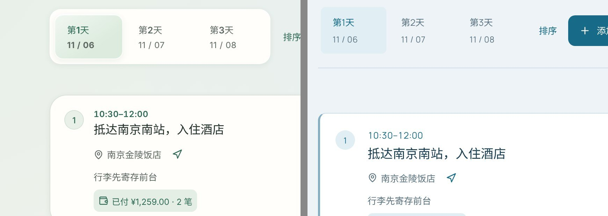

*左：绿色版，标题、时间和选中的日期标签都是粗体。右：图册版，全部变成了常规体。*

**原因**：`atlas.css` 把全站字体的第一位设成了 `'Journey Manrope'`，但项目里只带了 Manrope 的 **400（常规）一个字重**；而 `styles.css` 第 5 行设了 `font-synthesis: none`，不允许浏览器自己合成粗体。于是所有声明了 500 / 600 粗细的地方，数字和拉丁字母都只能用常规体显示：活动标题、时间、选中的日期标签、金额、按钮文字都受影响。

不同系统上的表现：

- **macOS / iOS**：汉字回退到苹方，能显示粗体，但同一行里的数字和字母是常规体。比如“第**1**天”里，“第”“天”是粗体，“1”是常规体。
- **本次测试用的 Linux Chrome**：中文和数字都变成了常规体（见上图）。

**修改**（任选其一）：

- 换成 Manrope 的可变字体（woff2，覆盖 200–800 字重，约 50KB），`@font-face` 写 `font-weight: 200 800`。
- 去掉 Manrope，数字和字母继续使用系统字体（SF Pro / Segoe UI）。系统字体的数字已经足够好看，这样做也最省事。

不论选哪种，字体文件都应改成 woff2；现在的 ttf 有 96KB。

#### D-2　衬线标题字体只包含 24 个字，动态标题会混用字体（P1）

`journey-serif.ttf` 只包含这 24 个字：

> 一从出划发同回我旅来欢理用的程管行计费起迎这里

但 `atlas.css` 把它用在了内容会变化的地方：继续旅程卡片上的**旅程名**、**所有弹窗标题**、地图上的**地点名**。字体里没有的字会逐个回退：macOS 上回退到宋体（Songti SC），Windows 上通常回退到宋体 / 新宋体。宋体本身又没有 600 字重，加上不允许合成粗体，只能用细体显示。

结果是一行标题里出现两种字体、两种粗细。例如弹窗标题“同行的伙伴”：“同行的”是思源宋体粗体，“伙伴”是系统宋体细体；“南京周末 · 秋日漫游”这类旅程名则整行都是回退字体。

**修改**：

- 衬线字体只用在**写死的文字**上：页面标题、品牌字、登录页标语。不要用在旅程名、弹窗标题、地点名等动态内容上。
- 子集改由构建脚本扫描这些固定文案自动生成，避免以后新增标题时忘了把字加进子集。
- 如果确实希望动态标题也用衬线，就需要按 `unicode-range` 分片加载完整的思源宋体（类似 Google Fonts 的分片方式），体积和加载时间都要单独评估。不建议为此增加这部分成本。
- 建议衬线标题只在“海图蓝”主题下启用，“森林绿”继续使用无衬线。这样两个主题在字体上也有区别，切换主题的感受更明显。

#### D-3　`atlas.css` 又叠了一层覆盖样式（P1）

全部 837 行都以 `:root` 开头，目的是提高优先级、盖过 `styles.css`。这正是第一轮审查 V-4 指出的问题（多层补丁互相覆盖，改一处、另一处跟着变），现在又多了一层。改成双主题时，必须同时拆分这个文件，见下一节。

#### D-4　设计文档里写了预览账号的密码（P3）

`docs/设计文档/09-旅行图册视觉重设计.md` 写明了本地预览账号和密码，并已推送到 `origin/dev`。这个账号只用于本地预览，风险不大，但不应养成把凭据写进仓库的习惯。建议移到 `.local/` 下的说明文件里。

---

## 二、对比截图

### 桌面浅色

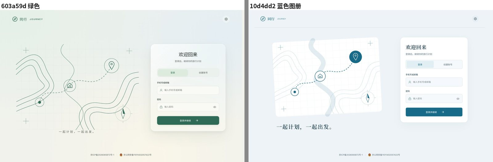
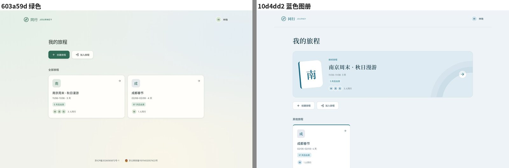
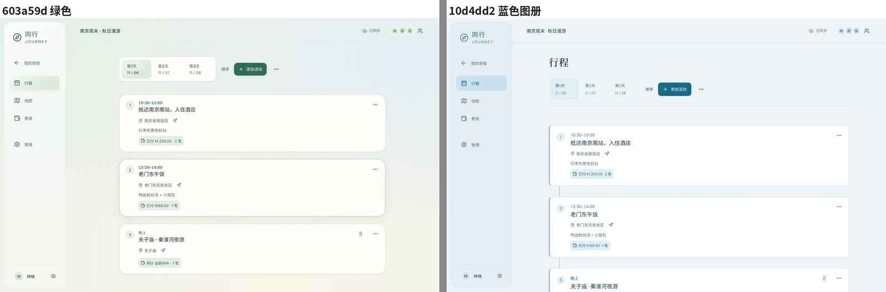
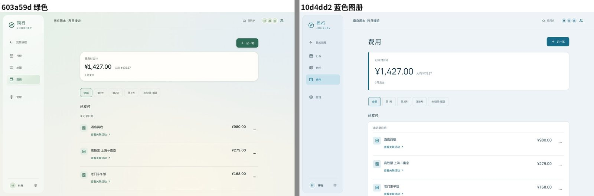
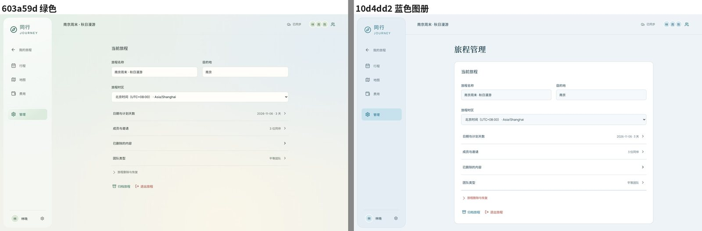
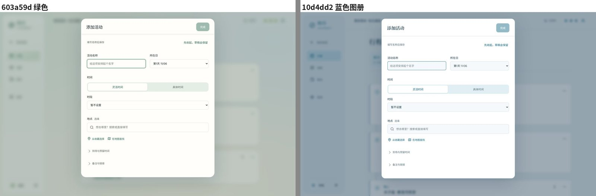

### 桌面深色

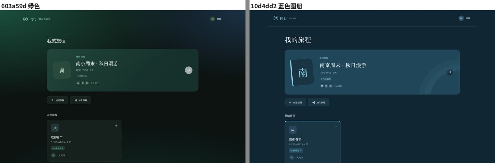
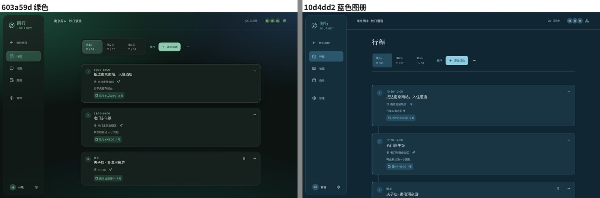

### 手机

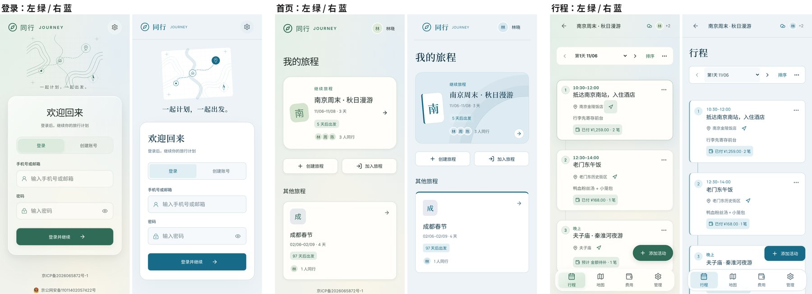
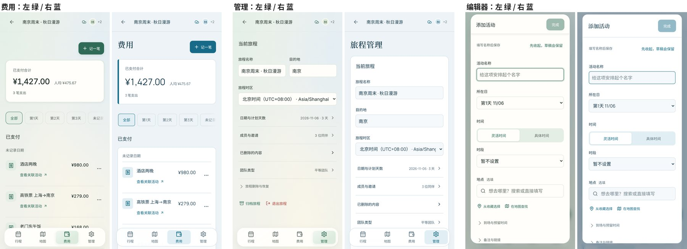
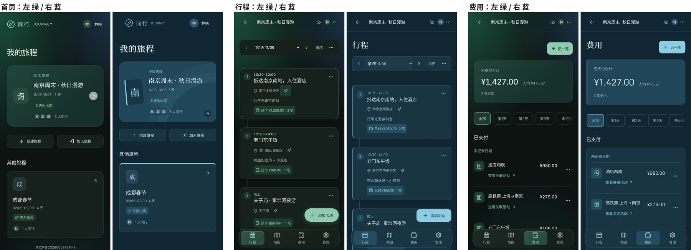

### 两套配色各自的长处

- **森林绿**：上一轮调整后，深色版有翡翠绿和青蓝两团光晕，氛围感更强；和原生 App 的现有配色一致。
- **海图蓝**：浅色版更清爽、更“工具化”；深色版的海军蓝底色稳重，对比度充足（正文 10.8 : 1，次要文字 6.6 : 1），长时间看不累。
- 两者都成立，适合并存，让用户自己选。

---

## 三、双主题实施方案

### 0. 主题色和材质分开：纯平样式交给“减少透明效果”

主题只管颜色，材质由“显示与动效 → 减少透明效果”决定，两者可以自由组合：

| | 减少透明效果：关（默认） | 减少透明效果：开 |
| --- | --- | --- |
| 森林绿 | 绿 + 轻玻璃 | 绿 + 纯平实底 |
| 海图蓝 | 蓝 + 轻玻璃 | 蓝 + 纯平实底 |

这样做的好处：

- 图册版的纯平质感两套颜色都能用，喜欢毛玻璃的人也能在海图蓝下保留玻璃。
- 设置为“跟随系统”时，已在 macOS / iOS 打开“降低透明度”的用户会自动得到纯平样式。
- 不用为每个主题各写一套材质，代码更少。

**实现方式：用 token 覆盖，替换现有分散的规则。** 目前 `data-transparency` 相关的规则分散在 `styles.css`（31 处）、`navigation.css`、`map.css`、`team-mode.css`、`login.css`、`atlas.css` 等文件里，按元素一个个改背景。建议改成在 token 层统一覆盖，再删掉这些分散的规则：

```css
:root[data-transparency='true'] {
  --glass: var(--surface);
  --optical-panel: var(--surface);
  --optical-sheen: transparent;
  --surface-highlight: transparent;   /* 新增：专门用于卡片顶部内高光，不再借用 --optical-edge */
  --optical-shadow: transparent;
}
:root[data-transparency='true'] * {
  -webkit-backdrop-filter: none !important;
  backdrop-filter: none !important;
}
@media (prefers-reduced-transparency: reduce) {
  :root:not([data-transparency='false']) { /* 同上，由生成脚本输出 */ }
}
```

注意三点：

- **卡片的边界要靠细边线撑起来**。阴影去掉后，`--line` 和底色之间至少要能看清（对比度约 1.3 : 1 以上）。森林绿和海图蓝现有的 `--line` 都满足。
- **选中状态要保留浅色填充**。原型里侧栏选中项变成了白底加描边，不如带颜色的填充醒目。纯平模式下选中底板继续用 `--optical-selected`（不要用 `--accent-soft`，它与实底侧栏的对比度只有约 1.18 : 1）。
- **设置项说明改为**：“使用不透明的实底卡片和面板，不显示毛玻璃和高光。”名称保持“减少透明效果”，与系统设置的叫法一致。

**原生端**：
- iOS 读取 `@Environment(\.accessibilityReduceTransparency)`，与应用内的设置取“或”。系统的 `.glassEffect` 会自动遵循系统设置；应用自己画的卡片、导航背景要按这个值切换为实底。
- Android 没有对应的系统开关，以应用内设置为准。

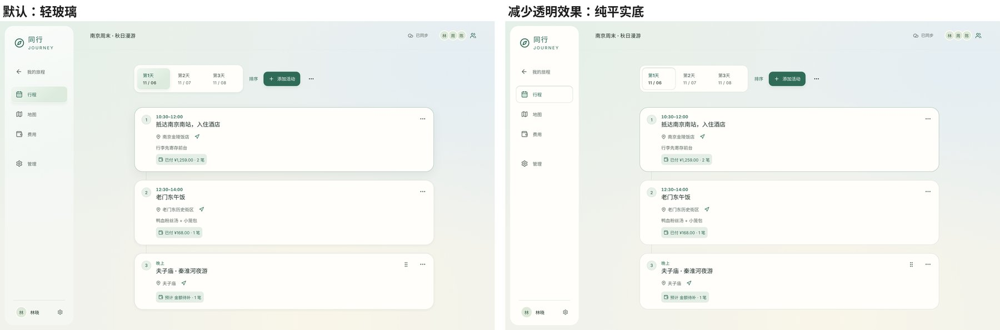

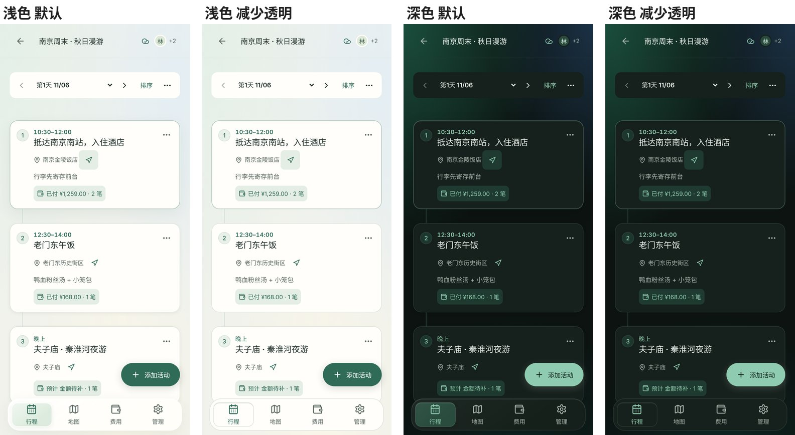

*上图是在绿色版上临时注入上面这段 token 覆盖得到的原型，未修改仓库代码。*

### 1. 配色进入 `design/tokens.json`

在 token 文件里增加调色板这一层。共用的圆角、字号保持不变，颜色按“调色板 × 明暗”组织：

```json
{
  "palettes": {
    "forest": {
      "label": "森林绿",
      "light": { "primary": "#2f6b57", "page": "#f1f2ec", "surface": "#fffefa", "muted": "#5e6a63", "...": "..." },
      "dark":  { "primary": "#8fcbb0", "page": "#0c1311", "surface": "#16201c", "...": "..." }
    },
    "atlas": {
      "label": "海图蓝",
      "light": { "primary": "#176b88", "page": "#edf3f6", "surface": "#ffffff", "muted": "#536a77", "...": "..." },
      "dark":  { "primary": "#8ecce2", "onPrimary": "#123342", "page": "#102632", "surface": "#193543", "...": "..." }
    }
  },
  "radius": { "sm": 8, "md": 12, "lg": 16, "xl": 24, "pill": 999 },
  "font":   { "caption": 12, "meta": 13, "body": 15, "title": 17, "section": 20, "page": 28 }
}
```

`page-background`、`hero-surface`、`avatar-bg / fg`、`elevated`、环境光等现有的网页 token，也一起按调色板分开存放。

### 2. 生成脚本输出

`scripts/generate-design-tokens.mjs` 改为输出：

```css
/* 默认：森林绿 */
:root, :root[data-palette='forest'] { ... }
:root[data-theme='dark'], :root[data-palette='forest'][data-theme='dark'] { ... }
@media (prefers-color-scheme: dark) { :root:not([data-theme='light']):not([data-theme='dark']) { ... } }

/* 海图蓝 */
:root[data-palette='atlas'] { ... }
:root[data-palette='atlas'][data-theme='dark'] { ... }
@media (prefers-color-scheme: dark) {
  :root[data-palette='atlas']:not([data-theme='light']):not([data-theme='dark']) { ... }
}
```

跟随系统的暗色分支也交给脚本生成，避免手写两份。

iOS 的 `Theme.swift` 和 Android 的 `Theme.kt` 同时生成 `Palette.forest / Palette.atlas` 两套，由用户偏好切换。

### 3. 拆分 `atlas.css`

| 去向 | 内容 | 预计行数 |
| --- | --- | --- |
| `tokens.json` | 第 14–100 行的全部颜色变量（圆角那几行删除） | — |
| 并入共用样式（`styles.css` 及各组件 css），去掉 `:root` 前缀 | B 类优化：日期标签条、设置分区卡片、费用分组卡片、输入框底色、地图菜单不透明、弹窗整理、3 列网格 | 约 350 行，合并后可以删掉原有的一部分旧规则 |
| 新文件 `palette-atlas.css`，所有规则以 `:root[data-palette='atlas']` 开头 | 继续旅程书脊、等高线同心圆、衬线标题（只用于固定文案） | 约 60 行 |
| 删除 | C 类中建议不保留的部分：圆角覆盖、多余的强调竖条、红色折叠标题、10px 品牌字 | — |

### 4. 用户入口

- **位置**：个人设置 → 显示与动效 → 新增“主题色”，用两个带色块的分段按钮：“森林绿 / 海图蓝”。放在现有的“外观：跟随系统 / 浅色 / 深色”上方。
- **保存**：写入账号偏好（`PATCH /api/me` 的 `preferences.palette`），换设备登录时自动沿用；同时写入 `localStorage`，未登录时也能生效。
- **避免闪烁**：在 `index.html` 的 `<head>` 里加一段很短的内联脚本，页面渲染前先从 `localStorage` 读出主题色，设置到 `<html data-palette>` 上，避免先闪一下绿色再变蓝。`<meta name="theme-color">` 也要跟着切换。
- **原生端**：iOS 和 Android 读同一个偏好字段，设置页里放同样的选项。

### 5. 先修 D 类问题

按 D-1、D-2 的修改处理字体。修好之前，蓝色主题不应作为默认主题对外发布。

### 6. 验收

- 两套调色板 × 浅色 / 深色 / 跟随系统，共 6 种组合，运行现有的 `atlas-review.spec.mjs` 和 `design-review-1101.spec.mjs`，每种组合都无横向溢出、无控制台错误。
- 新增一个对比度检查脚本：每套调色板的正文、次要文字、主色、主按钮文字、占位符，在 `bg / surface / elevated / accent-soft` 上的对比度都要达标（正文类 ≥ 4.5，占位符 ≥ 3）。
- 字重检查：活动标题、时间、选中标签、金额的计算字重为 600，且实际渲染为粗体（截图对比）。
- 字体检查：弹窗标题、旅程名、地点名不使用衬线子集字体。
- 切换主题色后刷新页面没有闪烁；换一台设备登录，主题色保持一致。
- iOS 和 Android 各截两种主题色的首页和行程页。

## 四、处理顺序

1. **先修 D-1 字重**：影响全站，改动小。
2. **拆分 `atlas.css`**：B 类并入共用样式，C 类删除，蓝色主题专属装饰单独成文件。
3. **配色进入 `tokens.json`**，生成脚本支持两套调色板，网页先上线切换。
4. **修 D-2 衬线字体**，并把衬线标题限定在海图蓝主题。
5. **设置入口、偏好同步、防闪烁脚本**。
6. **原生端两套调色板**。
7. 按第三节第 6 条验收，再决定默认主题是哪一套。

## 实施跟踪（2026-11-02）

本报告保留原始评估和截图。当前代码处理及验收证据统一记录在[双主题与设置修复](../../实施记录/2026-11-02-双主题与设置修复.md)，执行状态见[审查索引](../前端设计审查索引.md)。
