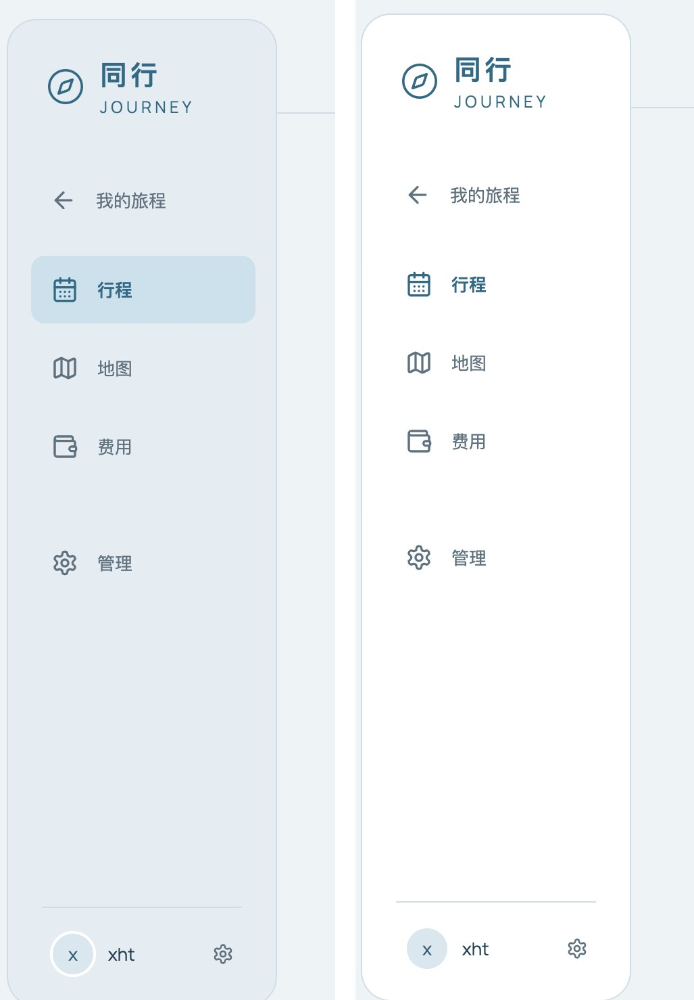
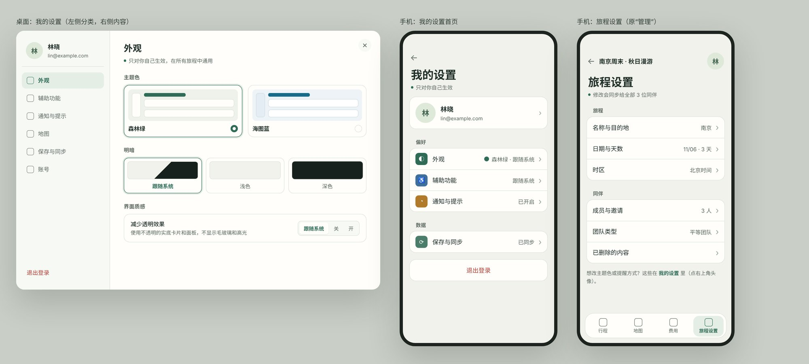

# 设置结构重设计与“减少透明效果”修复

> 日期：2026-11-02　｜　接续：[图册改版评估与双主题方案](../2026-11-01-图册改版评估/图册改版评估与双主题方案-2026-11-01.md)

## 一、“减少透明效果”开启后侧栏选中项看不见（Bug，P1）



*左：默认，“行程”有浅蓝底板。右：开启“减少透明效果”后，底板消失，只剩文字颜色的细微差别。*

**原因**：`app/src/navigation.css` 第 250–262 行，在开启“减少透明效果”时把 `.selection-indicator` 的背景改成了 `var(--surface)`。侧栏在这个模式下也是 `var(--surface)`，于是选中底板和侧栏同色，看不出来了。底部导航（`.bottom-nav`）和日期标签条用的是同一个底板组件，也受影响。

**修改**：保留去掉模糊的处理，但底板颜色改用默认模式下同一个选中色，不要换成和侧栏相同的颜色：

```css
:root[data-transparency='true'] .selection-indicator {
  background: var(--optical-selected);     /* 改这里：原为 var(--surface) */
  backdrop-filter: none;
  -webkit-backdrop-filter: none;
}
/* prefers-reduced-transparency 分支同样修改 */
```

如果按上一份文档第三节第 0 条改成 token 覆盖，纯平模式下保留 `--optical-selected` 原值即可，这里的单独规则就可以删掉。（上一份文档的原型里曾把它覆盖成 `--accent-soft`，与侧栏的对比度只有约 1.18 : 1，偏弱，以本条为准。）

**验收**：森林绿、海图蓝 × 浅色、深色，开启“减少透明效果”后，侧栏、底栏、日期标签的选中项都有明显的底色。参考值：森林绿浅色 `#dcebdd / #fffefa` 约 1.23 : 1，海图蓝浅色 `#c7e2ed / #ffffff` 约 1.35 : 1，深色模式两套都在 1.6 : 1 以上，都能看清；`--accent-soft` 只有约 1.18 : 1，不建议用作选中底板。

## 二、两个“设置”让用户分不清

### 现状

| | 个人设置 | 管理 |
| --- | --- | --- |
| 入口 | 桌面：侧栏底部头像 + 齿轮图标；首页右上角头像。**手机进入旅程后没有入口** | 侧栏 / 底栏第 4 项，**图标也是齿轮** |
| 内容 | 称呼、外观、减少动态、减少透明、地图自动收起侧栏、提示音、触感、通知、保存与同步、退出登录 | 旅程名称、目的地、时区、日期、成员与邀请、已删除内容、团队类型、归档、退出旅程 |
| 影响范围 | 只影响自己 | 影响所有同伴 |

问题：

1. **同一个齿轮图标表示两件事**。侧栏里“管理”和底部的个人入口都是齿轮，用户会以为两个入口通往同一个地方。
2. **页面上没有说明影响范围**。用户最需要知道的是“改了这里，别人会不会看到”，现在要靠猜。
3. **“管理”这个词太泛**，看不出是在管理旅程、管理成员还是管理账号。
4. **手机进入旅程后找不到个人设置**，只能先退回首页。

### 修改

- **改名**：“管理”改为**“旅程设置”**；“个人设置”改为**“我的设置”**。两个名字一眼就能看出管的是谁。
- **改图标**：旅程设置用滑块图标（iOS 已经在用）；我的设置只用头像表示，去掉侧栏底部头像旁的齿轮。全站只有一个“设置”含义的图标。
- **在标题下面写明范围**：
  - 旅程设置：“修改会同步给全部 3 位同伴”
  - 我的设置：“只对你自己生效，在所有旅程中通用”
- **互相指路**：旅程设置页底部加一行“想改主题色或提醒方式？在我的设置里（点右上角头像）”；我的设置里不放旅程相关的内容。
- **手机顶栏恢复“我”的入口**：右上角显示自己的头像，点开是我的设置；同伴头像叠放在旁边，点开是成员与邀请。两者用间距和描边区分。

## 三、“我的设置”界面重新组织

### 现状的问题

- 一个长弹窗，内容高度 1281px，可视区域只有 751px，要滚动近两屏。
- 同类的选择用了四种不同控件：外观和两个辅助功能是下拉框（跟随系统 / 开 / 关），地图和提示音是开关，通知是“开启”按钮，同步是一个状态加按钮。
- 不同性质的东西混在一起：偏好（外观）、桌面专用的行为（地图自动收起侧栏）、状态和工具（保存与同步、本机存储）、账号操作（退出登录）。
- 顶部第一个分区上方有一条多余的分隔线。
- 再加入主题色，又会多出一个下拉框，更乱。

### 新结构



*样稿用的是森林绿浅色 token，只表达结构和控件形式，图标是占位。*

**分类**：

| 分类 | 内容 | 控件 |
| --- | --- | --- |
| 外观 | 主题色（森林绿 / 海图蓝）、明暗（跟随系统 / 浅色 / 深色）、减少透明效果 | 主题色和明暗用**带缩略预览的卡片**，点了立即生效；减少透明效果用三段分段控件，并写明作用 |
| 辅助功能 | 减少动态效果 | 三段分段控件（跟随系统 / 关 / 开），与上面保持一致 |
| 通知与提示 | 同伴修改提醒、轻提示音、触感反馈（仅手机显示） | 开关；通知未获浏览器授权时，开关下方显示一行说明和“去授权” |
| 地图 | 地图自动收起侧栏（仅桌面显示） | 开关 |
| 保存与同步 | 同步状态、立即同步、本机存储 | 沿用现有内容，从设置里独立成一页；顶栏的同步图标也直接打开这一页 |
| 账号 | 称呼、登录账号 | 输入框；退出登录放在分类列表最底部，红色 |

**布局**：

- **桌面**：弹窗加宽到约 900 × 640px，左侧 232px 是分类列表（顶部显示头像、称呼和邮箱），右侧是当前分类的内容。每个分类的内容都在一屏以内，不需要滚动。
- **手机**：全屏页面，首页是头像卡片加分组列表（偏好 / 数据 / 退出登录），每一行右侧显示当前值（如“森林绿 · 跟随系统”）；点进去是对应的分类页。这是 iOS 设置和大多数 App 的通用做法，用户不需要学习。
- **统一控件规则**：
  - 有“跟随系统”的三态选项 → 分段控件
  - 只有开 / 关 → 开关
  - 有多个可视化选项（主题色、明暗）→ 带预览的卡片
  - 不再使用原生下拉框
- 每一行的格式统一：左边是名称（14–15px）和一行说明（12.5px，次要文字色），右边是控件；行高 52–56px。

**主题色卡片**：每张卡片里画一个缩略界面（侧栏 + 标题条 + 两张卡片），用该主题的真实颜色绘制，选中时加主色描边和外圈。这样选主题前就能看到效果，比两个文字选项直观得多。

## 四、处理顺序

1. 修复第一节的选中底板颜色（几行 CSS）。
2. 改名、换图标、加范围说明、手机顶栏恢复“我”的入口（第二节）。
3. 我的设置拆分为分类结构（第三节），同时加入主题色选项。
4. 原生端同步：iOS 用 `Form` + `NavigationLink` 分组，Android 用 `ListItem` 分组，分类和名称与网页一致。

## 实施跟踪（2026-11-02）

本报告保留原始评估和截图。当前代码处理及验收证据统一记录在[双主题与设置修复](../../实施记录/2026-11-02-双主题与设置修复.md)，执行状态见[审查索引](../前端设计审查索引.md)。
