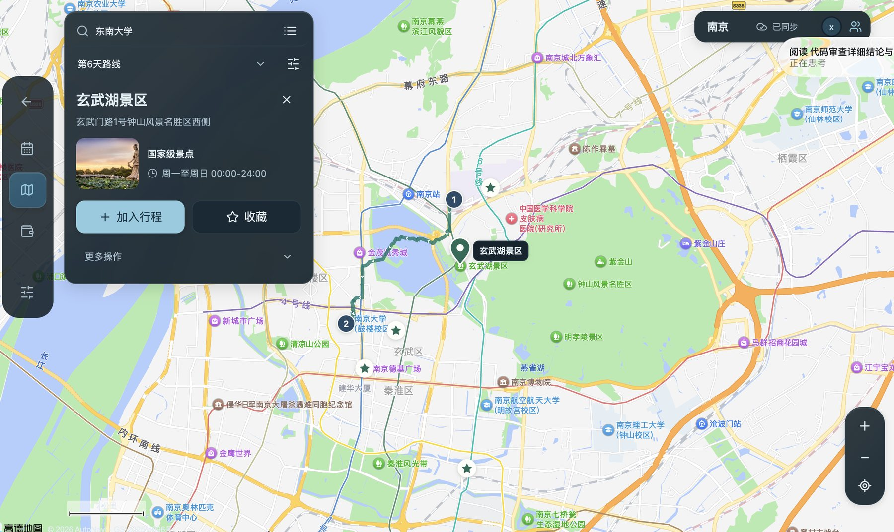
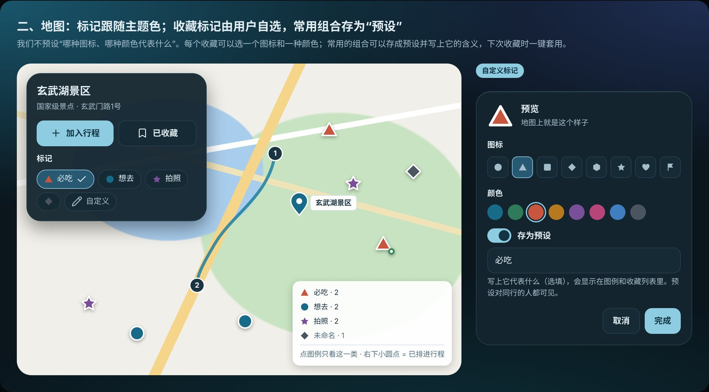
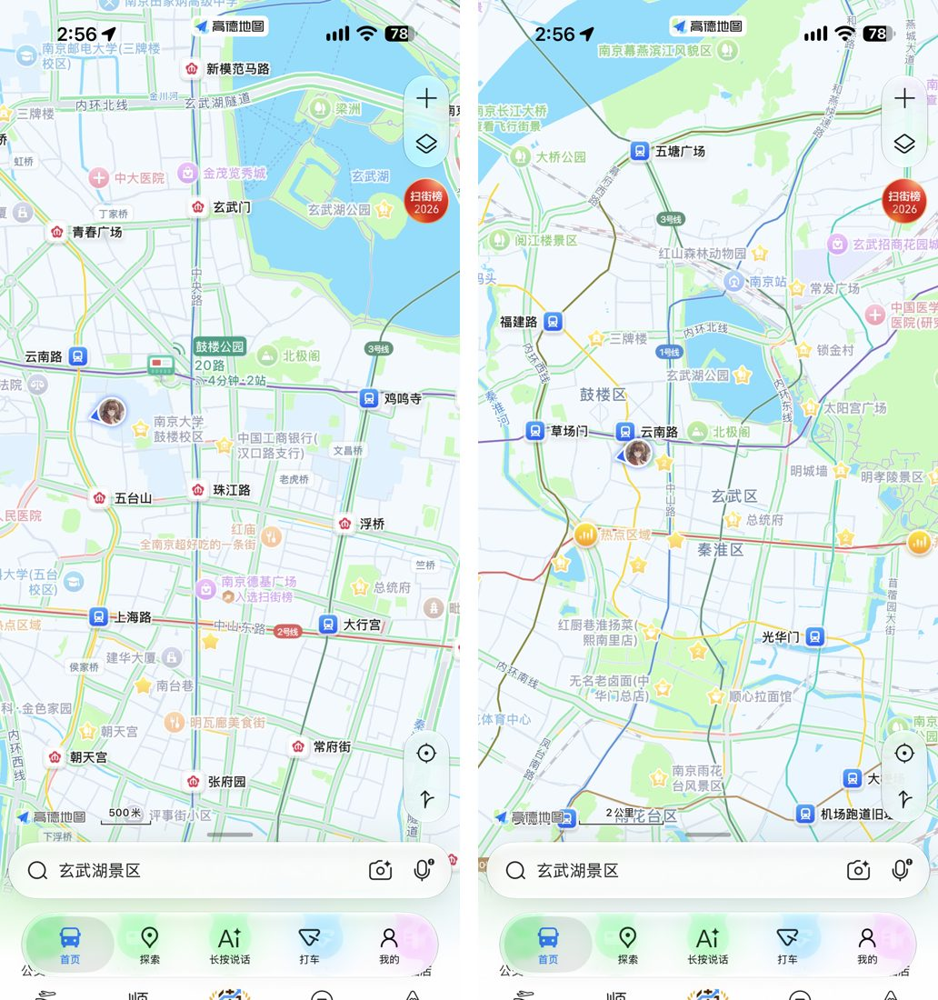
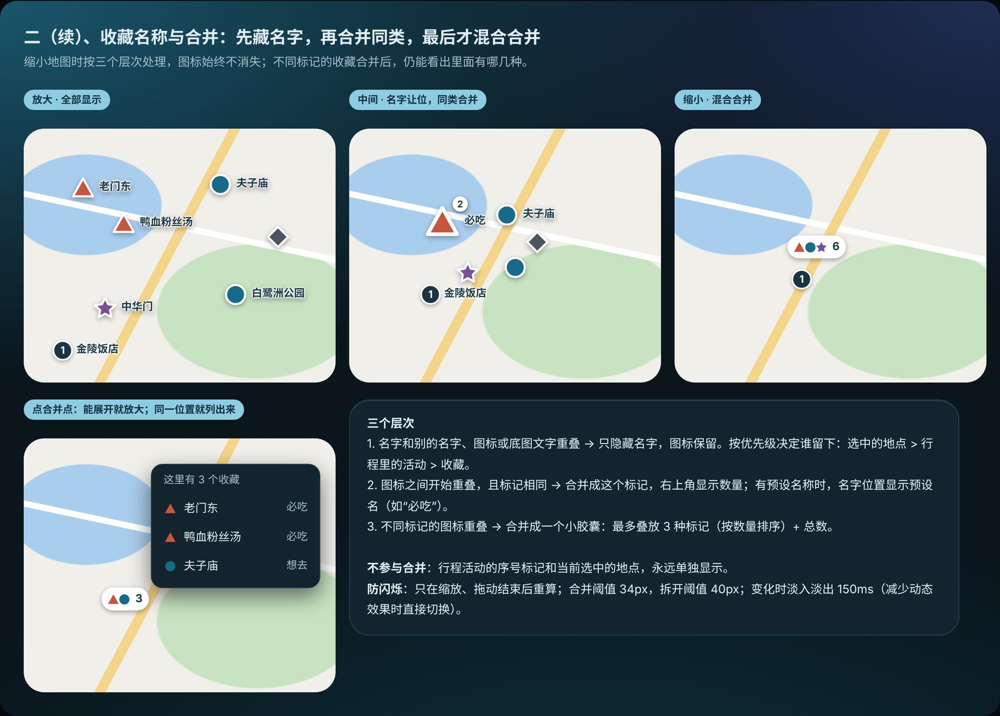
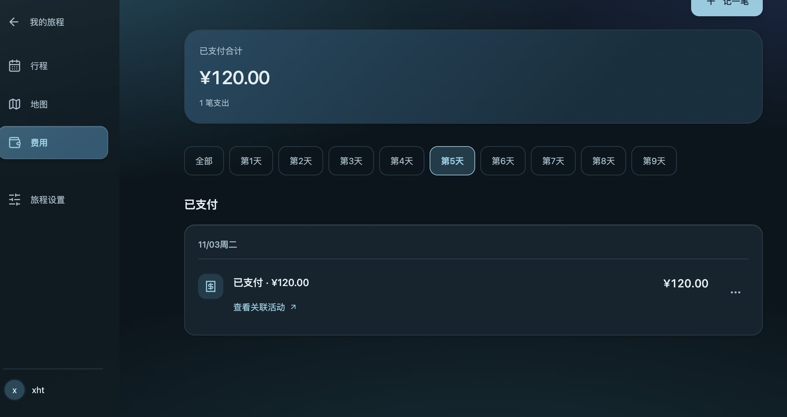
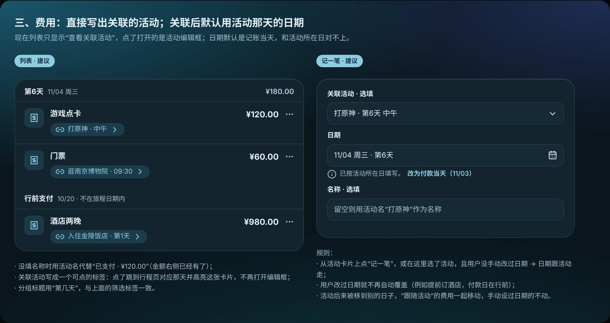
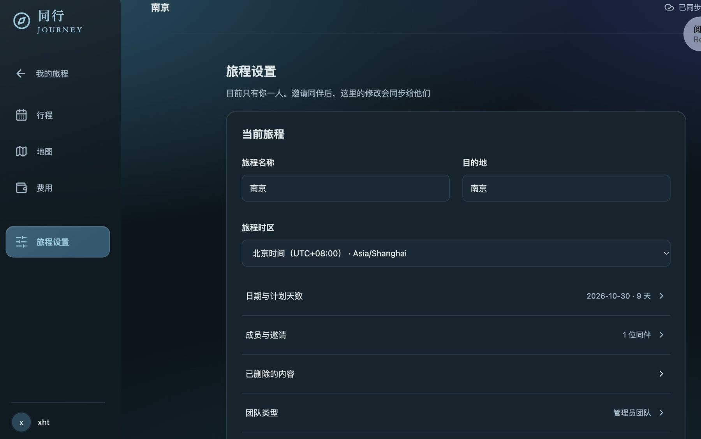
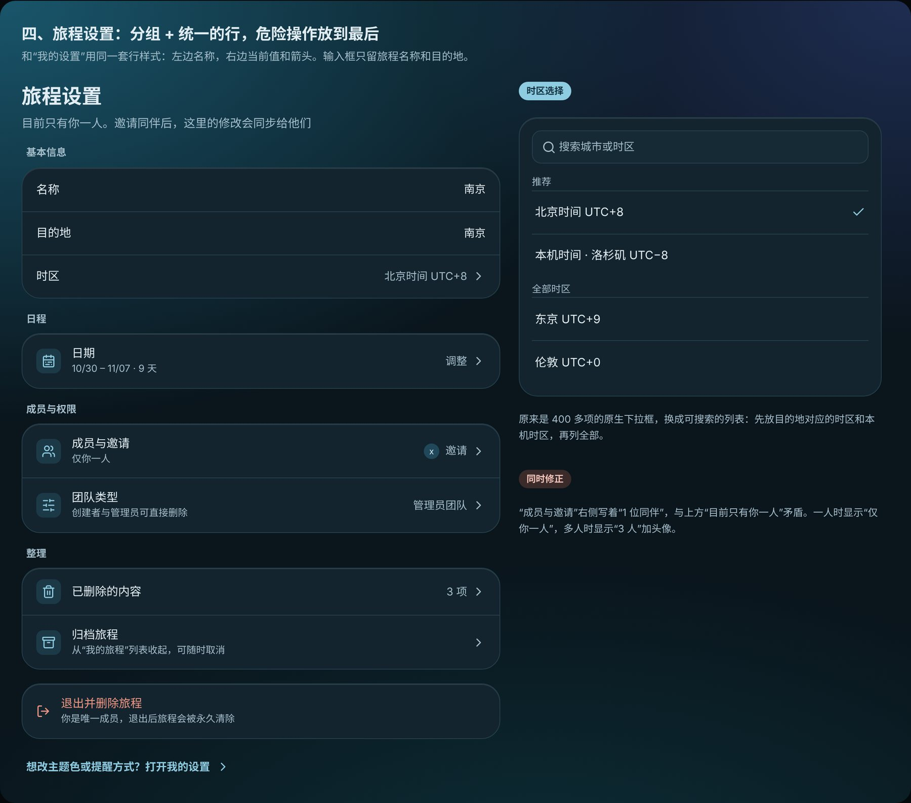
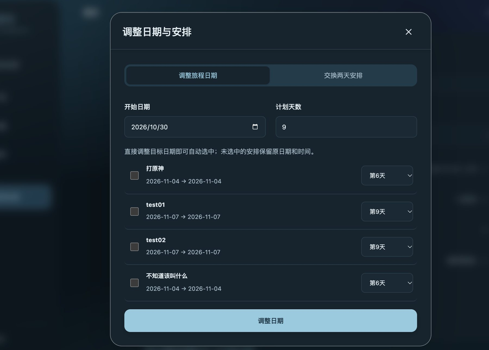
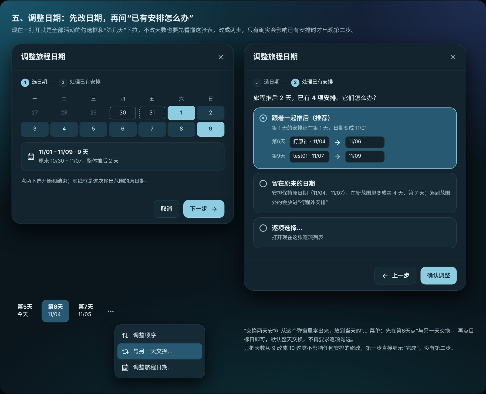

# 行程、地图、费用与旅程设置的交互修改建议

> 日期：2026-11-03　｜　基于：`dev` 分支 `a1fa531`　｜　样稿：[交互样稿.html](交互样稿.html)（双击用浏览器打开）

这一轮复查的是用户实际使用时卡住的几处：行程的“排序”开关、地图在海图蓝下的颜色、收藏标记、费用与活动的关联、旅程设置页、调整日期弹窗。下面每一节都先说明现在的代码实际做了什么，再给出修改方案。样稿用的是海图蓝深色，只用来表达结构和交互，图标是占位。

## 总览

| # | 问题 | 性质 | 影响范围 | 优先级 |
| --- | --- | --- | --- | --- |
| 1 | “排序 / 完成排序”在桌面端几乎没有可见变化 | 交互 | 网页；手机端同步改名 | P2 |
| 2 | 海图蓝下地图选中标记、星标、路线、筛选按钮仍是绿色 | Bug | 网页 | P1 |
| 3 | 收藏只有星标，不能区分 | 新功能 | 三端 + 数据协议 | P3 |
| 3b | 地图上不显示收藏的名字；收藏多了叠在一起 | 交互 | 三端 | P2 |
| 4 | 费用只显示“查看关联活动”，点开是编辑框；日期默认是记账当天 | 交互 + 规则 | 三端 | P1 |
| 5 | 旅程设置所有内容挤在一个卡片里；“1 位同伴”与“只有你一人”矛盾 | 结构 + Bug | 三端 | P2（Bug 为 P1） |
| 6 | 调整日期弹窗新用户看不懂 | 交互 | 三端 | P1 |

## 一、排序开关

### 现在做了什么

`Itinerary.jsx` 里的 `sorting` 状态（第 624 行）只影响三件事：

1. 手机端（`itinerary.css` 第 203–211 行，只在 `max-width: 760px` 内）：平时隐藏拖动手柄，进入排序后才显示。
2. 有具体时间的活动显示一个“按时间排序”的锁形标记（第 1050–1055 行）。
3. 手机端顺带显示空路程槽里的“添加路程”（`itinerary.css` 第 346 行）。

桌面端的拖动手柄本来就一直显示，拖动后立即保存。所以在桌面上点“排序”，如果当天全是“上午 / 中午”这类没有具体时间的活动，画面上唯一的变化就是按钮文字从“排序”变成“完成排序”。这个开关在桌面上没有作用，用户自然看不懂。

### 修改

- **桌面**：去掉“排序”按钮。鼠标移到卡片上时，卡片左侧出现拖动手柄，悬停提示“拖动调整顺序 · 也可用 ↑ ↓ 键”。有具体时间的活动没有手柄，时间后面加一个小锁，悬停提示“按具体时间排列，改时间即可调整位置”。
- **手机**：保留模式切换（避免滚动时误拖），但：
  - 改名为“调整顺序”，放进当天的“…”菜单，不占工具栏位置；
  - 进入后卡片收成一行（标题 + 时间 / 地点），顶部一条说明“按住 ⋮⋮ 拖动调整顺序；有具体时间的安排会按时间自动排列”，右上角“完成”；
  - 不再顺带显示“添加路程”，两件事分开。
- iOS、Android 的同名入口一起改名。

## 二、地图

### 2.1 海图蓝下仍是绿色（Bug）

原因是这些颜色写死在代码里，没有走主题 token：

| 位置 | 用途 | 现值 |
| --- | --- | --- |
| `map-markers.css` 第 11 行 | 选中标记、收藏星标（`currentColor`） | `#246b58` |
| `map-markers.css` 第 35 行 | 已安排收藏的底色 | `#e5eee5` |
| `map-markers.css` 第 39 行 | 路线序号底色 | `#294c68` |
| `MapView.jsx` 第 506 行 | 路线折线 `strokeColor` | `'#18786b'` |
| `map.css` 第 235、247 行 | 筛选面板按钮、选中的筛选标签 | `#bcd2c5`、`#1c7866` |

**修改**：在 `design/tokens.json` 里加一组地图专用 token。地图底图在深色模式下仍是浅色，所以这组颜色**两种明暗都用浅色模式的主色**，不要直接用 `--accent`（深色下是浅蓝，在白底图上看不清）。

| token | 森林绿 | 海图蓝 |
| --- | --- | --- |
| `map-accent`（选中标记、默认收藏） | `#246b58` | `#176b88` |
| `map-accent-soft`（已安排收藏底色） | `#e5eee5` | `#e1eff4` |
| `map-route`（路线折线） | `#18786b` | `#1f7fa3` |
| `map-route-marker`（路线序号底色） | `#294c68` | `#1b3442` |

- 折线颜色在 JS 里设置，需要用 `getComputedStyle(document.documentElement).getPropertyValue('--map-route')` 读取，并在主题切换时重画（监听 `data-palette` 的变化，或在 `applyAppearance` 里发一个事件）。
- 筛选面板的两个颜色改用 `--elevated` 和 `--optical-selected` / `--accent`，与其他筛选标签一致。
- 原生端已经用 `palette.accent`（iOS `MapViews.swift` 第 180、189 行）和 `colorScheme.primary`（Android `NativeMap.kt` 第 37 行），会跟随主题；但如果原生地图底图在深色模式下也是浅色，同样应改用浅色模式的主色。

### 2.2 收藏标记：用户自选，常用组合存为“预设”

现在收藏的数据就是一个地点（`server/model.mjs` 中 `favorite: place`），地图上统一画成星标，没法区分。

**原则**：旅行规划因人而异，“必吃”“拍照点”“雨天备选”“带爸妈去”……我们无法替用户预先决定有哪些类型、每种类型用什么图标和颜色。所以产品只提供**图标和颜色两组素材**，含义完全由用户自己定义；同时把最常见的操作压到一次点击。

**概念**只有两个：

- **标记**：一个图标 + 一种颜色，例如“红色三角”。每个收藏都有一个标记，地图上就画成这个形状和颜色。
- **预设**：用户存下来的常用标记，可以写上它代表什么（例如“红色三角 = 必吃”），也可以不写。预设是旅程级的，同行的人都能看到和使用，这样大家对“红色三角”的理解一致。

**素材**（固定，不让用户任意取色）：

- 图标 8 个，只用没有固定含义的形状：圆、三角、方块、菱形、六边形、星、心、旗。不放刀叉、床这类有具体含义的图标，避免暗示分类。
- 颜色 8 种：海图蓝 `#176b88`、森林绿 `#2f7a5a`、珊瑚红 `#c8553d`、琥珀 `#b7791f`、梅紫 `#7a4f9a`、玫红 `#b8457a`、天蓝 `#3f7fbf`、石墨 `#4a5560`。都带 2px 白边，在高德底图的绿地、水面和道路上都能看清。
- 限定素材是为了简洁：64 种组合已经足够区分，形状在地图上缩小后仍好辨认，色觉障碍用户也能靠形状区分。

**交互**：

- **收藏不多一步**：点“收藏”立即保存，标记默认用你在这个旅程里上一次用过的标记；从没用过时，用主题色的圆点。
- **一键套用预设**：地点卡片的“已收藏”下方出现一行“标记”，列出所有预设（形状 + 名称），点一下即切换。末尾是“自定义”。
- **自定义**：选图标、选颜色，上方实时预览。打开“存为预设”就会出现一个输入框“它代表什么（选填）”，完成后这个组合出现在预设行里。
- **图例**：地图右下角列出本旅程用到的标记和数量，有名称的显示名称，没有的显示“未命名”。点一项只看这一类，再点恢复。
- **管理预设**：收藏列表顶部“管理预设”：改名称、改图标或颜色、调整顺序、删除。
  - 改名称：立即生效，图例和列表跟着变。
  - 改图标或颜色：提示“有 5 个地点在用这个标记，一起改吗？”，确认后一起更新。
  - 删除预设：已收藏的地点保留原来的标记，只是图例里变成“未命名”。
- 已排进行程的收藏，在标记右下角加一个小圆点（替代现在整块换底色）。
- 筛选面板原有的“类别”（按高德地点类别：餐饮、景点等）保留，它是客观数据，和用户的标记不冲突；再加一组“标记”。

**数据协议**（三端都要改）：

- `favorite` 增加 `mark`：`{ icon, color }`，两项都是枚举值；为空时按默认标记显示。
- 新增对象类型 `markPreset`：`{ icon, color, name }`，`name` 可为空、最多 12 个字。同一旅程里同一组合只能有一个预设（服务端校验）。
- 收藏和预设之间**按组合匹配，不存引用**：收藏自己记着图标和颜色，删除预设不会影响已收藏的地点；图例按组合查找有没有同名预设来显示名称。
- 修改预设的图标或颜色时，由服务端在同一事务里把使用旧组合的收藏一起改掉，避免三端各自批量修改时出现一半新一半旧。
- `favorite` 的修改现在整组走 `$place` 时钟（`model.mjs` 第 37 行），`mark` 要单独计时钟。否则一人刷新地点信息、另一人同时改标记时，后写的会把前一个整组覆盖。
- `operationSchema.objectType` 枚举加 `markPreset`。

**建议分两步**：第一步先修 2.1 的颜色（不改协议）；第二步一起做标记和预设。

### 2.3 收藏名称与合并显示

**现状**：

- 网页：每个收藏是一个 `AMap.Marker`，内容是自己画的 DOM（`MapView.jsx` 第 444–475 行），只有选中的地点才显示名字。收藏一多，星标会叠在一起。
- iOS：SwiftUI `Map` 里的 `Annotation` 已经把地点名作为标题传进去了（`MapViews.swift` 第 184 行），但没有合并。
- Android：用的是 MapLibre 的旧接口 `map.addMarker`（`NativeMap.kt` 第 139 行），名字只在点开后的气泡里出现，也没有合并。

高德自带的点聚合插件 `AMap.MarkerCluster` 不适合直接用：它按网格合并，自定义绘制函数 `renderClusterMarker` 只拿到数量 `count` 和合并点本身，拿不到里面有哪些点，没法画出“里面有哪几种标记”。所以建议自己写合并逻辑。收藏通常只有几十到几百个，计算量很小。

**规则：缩小时分三个层次，图标始终不消失**

1. **名字让位**：名字和别的名字、图标或底图文字重叠时，只隐藏名字，图标保留。优先级：选中的地点 > 当天行程里的活动 > 收藏。名字最多显示 8 个字，超出用省略号。
2. **相同标记合并**：两个标记相同的收藏，图标间距小于 34px 时合并，显示这个标记（稍大一号）和右上角的数量；有预设名称时，名字位置显示预设名，例如“必吃”。
3. **不同标记合并**：不同标记的收藏要重叠得更多（间距小于 24px）才合并，所以总是比相同标记晚一步。合并后是一个白色小胶囊：最多叠放 3 种标记（按数量从多到少）+ 总数，例如“▲●★ 6”。这样既不会挤成一团，也能看出里面有哪几类。

**不参与合并**：行程活动的序号标记和当前选中的地点，始终单独显示，名字优先显示。图例或筛选里隐藏的标记不参与计算。

**点击合并点**：

- 能展开就放大：把地图缩放到刚好装下里面所有地点（留出边距）。
- 已经放大到最大（第 18 级），或者这些地点几乎在同一位置（例如同一栋楼里的几家店）：弹出一个小列表，每行是标记、地点名和预设名，点一行就选中这个地点。
- 读屏：合并点的说明写成“3 个收藏：必吃 2，想去 1”。

**防止闪烁**：

- 只在缩放、拖动**结束后**重算，过程中保持上一次的结果。
- 合并和拆开用不同阈值（合并 34px，拆开 40px），避免在临界缩放级别反复跳动。
- 合并、拆开时淡入淡出 150ms；开启“减少动态效果”时直接切换。

**实现**：

三端用同一套合并算法（纯函数，输入每个点的屏幕坐标、标记、优先级，输出分组和每个名字是否显示），这样三端的表现一致，也方便写单元测试：

1. 按优先级、再按创建时间排序（保证结果稳定）。
2. 第一轮：相同标记、距离小于 34px 的合并成组。
3. 第二轮：任意两组距离小于 24px 的合并成混合组。
4. 按优先级给单点和相同标记组放名字：先试右侧，再试左侧；与已放下的图标或名字重叠就不放。

各端绘制：

| 端 | 图标与合并点 | 名字 |
| --- | --- | --- |
| 网页 | 继续用 `AMap.Marker` + 自绘 DOM（形状、数量角标、混合胶囊都好画） | 建议先试高德的 `LabelsLayer`：只放文字的 `LabelMarker`，开启 `collision`，用 `rank` 表示优先级。它在 JS API 2.0 里能和底图文字互相避让，可以避免我们的地名压在底图地名上。为了让名字也避开我们自己的图标，可以给每个图标加一个透明图片的 `LabelMarker` 占位（需要先做个小实验确认有效）；行不通就退回第 4 步自己算，并给文字加白色描边保证可读 |
| Android | 把旧的 `addMarker` 换成 `GeoJsonSource` + `SymbolLayer`：每种标记注册一张图，合并点按组合生成图片 | 同一个 `SymbolLayer` 的 `textField`；设 `iconAllowOverlap = true`、`textAllowOverlap = false`、`textOptional = true`（文字重叠时只隐藏文字、保留图标），`symbolSortKey` 表示优先级。MapLibre 会自动和底图文字避让 |
| iOS | `Map` 外面套 `MapReader`，在 `onMapCameraChange(frequency: .onEnd)` 里用 `MapProxy.convert` 算出屏幕坐标、跑合并算法，合并点也用 `Annotation` 画 | 继续用 `Annotation` 的标题，交给系统按 `annotationTitles(.automatic)` 决定是否显示；如果实测拥挤时不会自动隐藏，就用第 4 步的结果控制 |

**顺序**：名字显示和合并不依赖 2.2 的标记功能，可以先做：现在所有收藏都是同一种星标，只会出现“相同标记合并”；等标记和预设上线后，混合合并自然生效。

## 三、费用与关联活动

### 现在做了什么

- 新建费用时日期默认是当天（`Ledger.jsx` 第 44 行 `date: today(...)`），选择关联活动不会改日期。所以你在 11/03 记一笔关联 11/04 活动的费用，它被归到 11/03。
- 列表只显示“查看关联活动”，不写是哪个活动（第 559 行）；点击调用 `onEditActivity`（第 556 行），打开的是活动编辑框，而用户只是想看一眼。
- 没填名称时标题是“已支付 · ¥120.00”（第 542 行），和右侧金额重复。

### 这是刻意设计吗？是否合理？

费用日期和活动日期分开，**本身有道理**：提前订酒店、行前买门票，付款日确实不在活动那天。但**默认值不合理**：大多数费用就是活动当天花的，用户关联了活动以后，期望它出现在活动那天，而现在需要再手动改一次日期，绝大多数人不会注意到。代码里也没有说明这是有意的，更像是没考虑到。

### 修改

**日期规则**（不需要改数据协议）：

- 费用有 `activityId` 且 `date` 为空 → 视为“跟随活动”，显示和分组都用活动所在日的日期。活动以后被移到别的日子，费用自动跟着走。
- 用户手动选了日期 → 存下这个日期，不再跟随。
- 记一笔时选了活动，日期框显示活动日期，下方提示“已按活动所在日填写”，旁边一个文字按钮“改为付款当天（11/03）”，点了才写入具体日期。
- 从活动卡片上点“记一笔”时同样默认跟随。
- 没有关联活动、也没有日期的，仍归在“未记录日期”。
- 关联的活动被删除时，费用归到“未记录日期”，标签显示“关联活动已删除”。

**列表**：

- 关联活动写成一个带链接图标的标签：“打原神 · 中午 ›”。点击跳到行程页对应那天，滚动到这张卡片并高亮 1 秒，不再打开编辑框。需要编辑时，从行程页卡片的“…”进入。
- 没填名称时，用活动名作为标题；两者都没有，才显示“已支付 / 预计”。
- 分组标题改为“第 6 天 · 11/04 周三”，与上方筛选标签一致；不在旅程日期内的放在“行前支付 / 行后支付”组。
- iOS `ExpenseViews.swift`、Android 对应页面按同样规则显示和分组。

## 四、旅程设置

### 问题

- 所有内容都在一个“当前旅程”卡片里（`Settings.jsx` 第 361–445 行），只是从上到下排列：两个输入框、一个原生下拉框、三行链接、团队类型、一个折叠的“旅程删除与恢复”、两个按钮。控件形式有四五种，没有分组标题，危险操作（退出、删除）和普通设置混在一起。
- 时区是一个 400 多项的原生下拉框（第 381–391 行），很难找。
- **Bug**：“成员与邀请”右侧写“1 位同伴”（第 401 行，用的是成员总数），而页面顶部说“目前只有你一人”。

### 修改

和“我的设置”使用同一套行样式，分成五组：

| 分组 | 行 | 右侧显示 | 点击后 |
| --- | --- | --- | --- |
| 基本信息 | 名称、目的地 | 当前值 | 原位编辑（右对齐输入框，失焦保存） |
| | 时区 | “北京时间 UTC+8” | 可搜索的时区列表：先列目的地对应时区和本机时区，再列全部 |
| 日程 | 日期 | “10/30 – 11/07 · 9 天” | 第五节的新流程 |
| 成员与权限 | 成员与邀请 | 一人：“仅你一人”；多人：头像 + “3 人” | 成员页 |
| | 团队类型（仅创建者） | “管理员团队” | 选择页，附一句说明 |
| 整理 | 已删除的内容 | 数量 | 已删除列表 |
| | 归档旅程 | 说明“从我的旅程列表收起，可随时取消” | 确认后归档 |
| （无标题，单独一组） | 退出旅程 / 退出并删除旅程 | 红色，一人时说明会永久清除 | 现有确认弹窗 |

- 原来折叠的“旅程删除与恢复”：删除旅程放进最后一组（创建者可见），恢复留在“已删除的内容”里。
- 页尾保留“想改主题色或提醒方式？打开我的设置”。
- iOS `ManageViews.swift`、Android `Management.kt` 使用相同分组和名称。

## 五、调整日期与安排

### 为什么看不懂

1. **一个弹窗做两件不相关的事**：改整个旅程的日期范围，和交换某两天的安排。
2. **只想改日期，也要先看懂整张活动表**。表格的规则是“改了右边的第几天就自动勾选；不勾选的保留原日期”，但页面上没有说明“保留原日期”意味着什么：活动在日历上不动，它在旅程里是“第几天”就会变。
3. **默认行为和直觉相反**：把开始日期往后挪两天，什么都不勾，所有活动留在原来的日历日期上，于是“第 1 天”的安排变成了“第 0 天”（移出范围）。多数人挪日期时期望的是“整个行程一起挪”。
4. **点“调整日期”之前看不到结果**：哪些安排会动、动到哪一天，都要自己算。

### 修改

**第一步：选日期**

- 用日历选开始和结束（点两下），下方显示“11/01 – 11/09 · 9 天，原来 10/30 – 11/07，整体推后 2 天”。
- 被移出范围的原日期用虚线框标出。
- 如果这次修改不影响任何已有安排（例如只是把结束日期往后延），按钮直接是“完成”，没有第二步。

**第二步：已有安排怎么办**（只在有安排会受影响时出现）

按改动类型给出选项，每个选项下预览 2–3 条安排的“原日期 → 新日期”：

| 改动 | 选项（第一个为默认） |
| --- | --- |
| 整体前移 / 后移 | **跟着一起移动**：第几天不变，日期跟着变 ／ 留在原来的日期：日期不变，第几天变；落到范围外的放进“行程外安排” ／ 逐项选择… |
| 缩短天数，被删掉的日子上有安排 | **移到最后一天** ／ 放进“行程外安排” ／ 逐项选择… |

“逐项选择…”打开现在这张逐项列表，作为高级选项保留。

**和现有接口的对应**：后端 `reschedule` 操作已经支持 `moves`。“跟着一起移动”= 每项活动 `ordinal` 不变、给出新的 `date`；“留在原来的日期”= `moves` 为空；“逐项”= 现在的做法。只改前端，不需要改协议。

**交换两天**：从这个弹窗里移出，放到行程页当天的“…”菜单：“与另一天交换…”，然后点目标日即可，默认整天交换（两天的全部活动对调）。需要只换其中几项时，用拖动把活动拖到另一天的标签上（建议后续支持）。

## 六、建议的实施顺序

1. **小 Bug**：地图颜色 token（2.1）；“成员与邀请”人数文案（四）。
2. **费用**：日期跟随规则、关联活动标签、标题兜底（三）。
3. **调整日期**：两步流程，交换两天移到“…”菜单（五）。
4. **排序**：桌面去掉开关，手机改为“调整顺序”模式（一）。
5. **旅程设置**：分组重排、可搜索时区（四）。
6. **收藏名称与合并显示**：不依赖标记功能，可先做（2.3）。
7. **收藏标记与预设**：涉及三端数据协议，单独排期（2.2）。

## 七、验收

- 海图蓝浅色、深色下，地图的选中标记、收藏、路线、路线序号、筛选标签都不再出现绿色；切换主题后路线颜色立即更新，不需要刷新。
- 在 11/03 给 11/04 的活动记一笔费用、不改日期 → 出现在“第 6 天 · 11/04”；把活动移到 11/05 → 费用跟着移动；手动改成 11/03 的费用不动。
- 费用列表点关联活动标签 → 跳到行程页对应那天并高亮该卡片，不打开编辑框。
- 只有自己一人的旅程，“成员与邀请”显示“仅你一人”。
- 把开始日期后移 2 天、选“跟着一起移动”→ 每项活动的“第几天”不变；选“留在原来的日期”→ 日期不变。只延长结束日期时没有第二步。
- 收藏一个地点不需要额外操作，标记默认沿用上一次；把“红色三角”存为预设并命名“必吃”后，同行的人在地点卡片里能一键套用，图例显示“必吃”；把这个预设改成红色圆形，正在用它的地点一起变；删除预设后，地点保留红色圆形，图例显示“未命名”。
- 放大时收藏旁边显示地点名，名字与底图地名或其他名字重叠时只隐藏名字；缩小时相同标记先合并并显示数量，不同标记要更近才合并成胶囊；在临界缩放级别来回微调不闪烁；点合并点会放大展开，同一位置的几个收藏弹出列表。
- 桌面行程页没有“排序”按钮，悬停出现拖动手柄；手机端“调整顺序”模式顶部有说明，“完成”退出。
